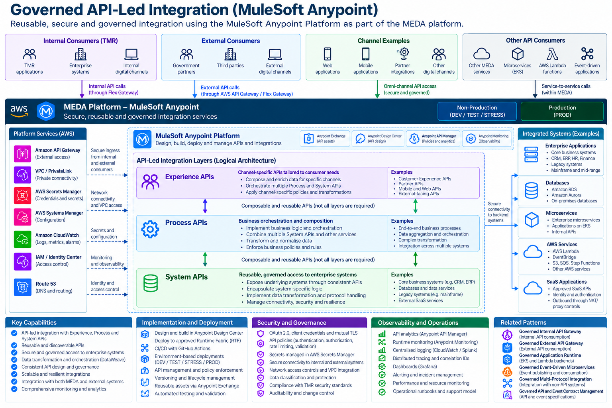

# Governed API-Led Integration

## 1. Introduction

The **Governed API-Led Integration** architectural pattern defines how TMR enterprise applications, business capabilities and digital channels are integrated through reusable, secure and centrally governed APIs using the MuleSoft Anypoint Platform.

The pattern establishes a consistent architectural approach to enterprise integration through three logical API layers:

- **Experience APIs** — Consumer-specific interfaces that expose business capabilities to applications and digital channels.
- **Process APIs** — Reusable business orchestration, aggregation and transformation across multiple systems.
- **System APIs** — Governed interfaces providing access to underlying enterprise systems, databases and services.

These layers support the separation of consumer requirements, business orchestration and system-specific integration concerns.

The pattern enables:

- Reusable enterprise integration services.
- Standardised API design and governance.
- Decoupling between applications and underlying enterprise systems.
- Integration with legacy and modern enterprise platforms.
- Business process orchestration.
- Data transformation using DataWeave.
- Secure connectivity to internal applications and approved SaaS services.
- Centralised API lifecycle management.
- Deployment through MuleSoft Runtime Fabric.
- Enterprise logging, monitoring and observability.

**Architectural principle:** Enterprise integration should expose reusable business capabilities through governed APIs, separating consumer-specific requirements, business orchestration and system connectivity without introducing unnecessary architectural layers.

---

## 2. Purpose and Architectural Outcomes

TMR operates a diverse enterprise technology landscape consisting of:

- Core business systems.
- Legacy applications.
- Enterprise databases.
- Modern microservices.
- Cloud-native services.
- Approved SaaS applications.
- Digital channels.
- External government and business partners.

Direct point-to-point integrations between these systems can introduce tight coupling, duplicated transformation logic, inconsistent security controls and increased maintenance costs.

The Governed API-Led Integration pattern establishes a reusable integration architecture using MuleSoft Anypoint Platform.

### 2.1 Architectural Outcomes

The pattern provides:

- Consistent enterprise integration architecture.
- Reusable APIs and business capabilities.
- Reduced point-to-point integration.
- Separation of consumer, business and system concerns.
- Centralised API governance.
- Consistent security enforcement.
- Standardised data transformation.
- Improved API discoverability.
- Independent API lifecycle management.
- Reduced impact from changes to underlying systems.
- Enterprise observability and operational support.

### 2.2 Core Architectural Decisions

| Decision | Architectural requirement |
|---|---|
| Integration platform | MuleSoft Anypoint Platform provides the approved API-led integration capability. |
| API architecture | Experience, Process and System APIs are logical architectural layers. |
| Layer selection | Not every integration requires all three layers. |
| API runtime | MuleSoft applications are deployed through approved Runtime Fabric environments. |
| API exposure | Internal and external access follows the applicable governed API gateway pattern. |
| API contracts | APIs use approved, versioned API specifications. |
| Transformation | DataWeave provides supported data mapping and transformation. |
| Authentication | APIs use approved enterprise authentication mechanisms. |
| Authorisation | API access is restricted through approved gateway and application policies. |
| Connectivity | Backend access uses approved private networking and governed external connectivity. |
| Reusability | Reusable APIs are documented and discoverable through approved catalogues. |
| Observability | API telemetry integrates with enterprise monitoring. |
| Deployment | APIs are deployed through approved CI/CD and infrastructure management processes. |

---

## 3. When to Use This Pattern

Use this pattern when TMR applications require reusable integration capabilities across enterprise systems.

Typical scenarios include:

- Exposing existing enterprise system capabilities through governed APIs.
- Integrating multiple backend systems into a single business process.
- Providing channel-specific APIs for digital applications.
- Orchestrating business operations across multiple enterprise services.
- Transforming data between incompatible system formats.
- Reducing direct dependencies on legacy applications.
- Providing consistent access to approved SaaS services.
- Reusing existing enterprise APIs across multiple applications.
- Modernising integration interfaces without replacing underlying systems.

### 3.1 When Not to Use This Pattern

This pattern should not automatically be used when:

- An existing API already satisfies the integration requirement.
- A simple backend API can be exposed through an approved gateway without additional integration logic.
- The requirement is primarily asynchronous event publication or consumption.
- Database replication or CDC is the appropriate integration mechanism.
- An additional API layer would provide no meaningful separation or reuse.
- The integration would duplicate an existing enterprise capability.

### 3.2 API Layer Selection Guidance

| Requirement | Recommended API layer |
|---|---|
| Expose an enterprise system capability | System API |
| Combine capabilities from multiple systems | Process API |
| Implement reusable business orchestration | Process API |
| Provide a channel-specific interface | Experience API |
| Adapt responses for mobile or web consumers | Experience API |
| Isolate backend-specific connectivity | System API |
| Provide simple access to an existing service | Existing API or appropriate System API |
| Implement asynchronous event processing | Governed event-driven integration pattern |

**Important:** Experience, Process and System APIs are logical architectural responsibilities, not mandatory sequential network hops.

---

## 4. Solution Architecture

### 4.1 Solution Architecture Diagram



The architecture illustrates how API consumers access reusable integration capabilities through MuleSoft Anypoint Platform.

It includes:

- Internal TMR consumers.
- Approved external consumers.
- Digital channels.
- Other MEDA applications and services.
- Governed API access.
- Experience APIs.
- Process APIs.
- System APIs.
- Enterprise applications.
- Databases.
- Microservices.
- AWS services.
- Approved SaaS applications.
- Platform security and operational capabilities.

### 4.2 Logical Architecture

```text
                    API CONSUMERS
                          |
          +---------------+---------------+
          |               |               |
          v               v               v
      Internal         External        Digital
     Applications      Partners        Channels
          |               |               |
          +---------------+---------------+
                          |
                          v
                 GOVERNED API ACCESS
                          |
                          v
               MULESOFT ANYPOINT PLATFORM
                          |
          +---------------+---------------+
          |                               |
          v                               v
    EXPERIENCE APIs                 DIRECT API ACCESS
          |                         WHERE APPROPRIATE
          v
      PROCESS APIs
          |
          v
      SYSTEM APIs
          |
          +---------------+---------------+
          |               |               |
          v               v               v
      Enterprise       Databases       Approved
       Systems                          SaaS APIs
```

The logical layers may be combined differently depending on the integration requirement.

A consumer may invoke an Experience API, Process API or System API directly where permitted by the approved architecture.

### 4.3 Experience APIs

Experience APIs provide interfaces tailored to specific consumer requirements.

Responsibilities may include:

- Channel-specific response composition.
- Consumer-oriented data transformation.
- Aggregation of Process API responses.
- Presentation of business capabilities.
- Consumer-specific interface contracts.

### 4.4 Process APIs

Process APIs implement reusable business orchestration.

Responsibilities may include:

- Coordinating multiple System APIs.
- Implementing integration-level business processes.
- Aggregating data from different systems.
- Applying business rules.
- Transforming and normalising data.
- Managing integration workflows.

### 4.5 System APIs

System APIs provide governed access to underlying enterprise systems.

Responsibilities may include:

- Backend connectivity.
- System-specific protocol handling.
- Data mapping.
- Encapsulation of backend-specific interfaces.
- Controlled access to enterprise data and operations.
- Isolation of consumers from backend implementation changes.

---

## 5. Architectural Governance and Tenancy

### 5.1 MuleSoft Anypoint Platform

MuleSoft Anypoint Platform provides the enterprise integration management capability.

Relevant services include:

- Anypoint Design Center.
- Anypoint Exchange.
- Anypoint API Manager.
- Anypoint Runtime Manager.
- Anypoint Monitoring.

These capabilities support API design, discovery, deployment, management and operational monitoring.

### 5.2 MuleSoft Runtime Fabric

MuleSoft applications execute through approved Runtime Fabric environments.

Within MEDA, Runtime Fabric is hosted on Amazon EKS.

The runtime architecture must address:

- Application deployment.
- Runtime capacity.
- Environment separation.
- Networking.
- Workload security.
- Application scaling.
- Availability.
- Monitoring.

### 5.3 Environment Separation

The architecture supports approved MEDA environments.

| Environment | Purpose |
|---|---|
| DEV | Development and integration testing |
| TEST | Functional and system testing |
| STRESS | Performance and load testing |
| PROD | Production workloads |

Actual environment placement must follow the approved MEDA account and runtime configuration.

### 5.4 Governance Responsibilities

| Responsibility | Primary capability |
|---|---|
| API design | Anypoint Design Center |
| API discovery | Anypoint Exchange |
| API policy management | Anypoint API Manager |
| Application deployment | Runtime Fabric and deployment automation |
| Runtime operations | Runtime Fabric and Anypoint Runtime Manager |
| API monitoring | Anypoint Monitoring and enterprise observability |
| Identity and access | Approved enterprise identity services |
| Secrets management | AWS Secrets Manager |
| Infrastructure governance | MEDA AWS platform controls |

---

## 6. Experience API Architecture

### 6.1 Purpose

Experience APIs expose business capabilities in a format appropriate to the consuming application or channel.

### 6.2 Consumer-Specific Interfaces

Different consumers may require different representations of the same underlying business capability.

Examples include:

- Web applications.
- Mobile applications.
- Internal enterprise portals.
- Partner applications.
- Digital customer channels.

### 6.3 Data Composition

Experience APIs may combine responses from Process APIs or other approved services.

### 6.4 Channel Independence

Consumer-specific requirements should not unnecessarily affect reusable business orchestration or underlying System APIs.

### 6.5 Experience API Governance

Experience APIs must define:

- API owner.
- Consumer requirements.
- API specification.
- Authentication.
- Authorisation.
- Versioning.
- Response contracts.
- Operational support.

### 6.6 Avoiding Unnecessary Experience APIs

An Experience API should not be introduced when an existing Process API or System API already provides an appropriate, governed interface.

---

## 7. Process API Architecture

### 7.1 Purpose

Process APIs provide reusable business orchestration and integration logic.

### 7.2 Business Orchestration

Process APIs may coordinate multiple services to complete a business operation.

For example:

```text
                  BUSINESS REQUEST
                         |
                         v
                     PROCESS API
                         |
           +-------------+-------------+
           |             |             |
           v             v             v
       System API A  System API B  System API C
           |             |             |
           v             v             v
        System A       System B       System C
```

### 7.3 Aggregation

Process APIs may aggregate information from multiple systems into a reusable business response.

### 7.4 Transformation

Process APIs may transform data into an agreed integration representation.

### 7.5 Business Rules

Process APIs may implement business rules associated with the integration process.

Core business-domain rules should remain with the appropriate owning business capability.

### 7.6 Error Handling

Process APIs must define how failures in dependent systems affect the overall operation.

This includes:

- Timeouts.
- Partial failures.
- Error responses.
- Retry behaviour.
- Compensation where required.

### 7.7 Reusability

Process APIs should represent business capabilities that may be reused across multiple consumers.

---

## 8. System API Architecture

### 8.1 Purpose

System APIs provide reusable access to underlying enterprise systems.

### 8.2 Backend Abstraction

System APIs isolate consumers from backend-specific details such as:

- Connection protocols.
- Authentication mechanisms.
- Data formats.
- Endpoint structures.
- System-specific error responses.

### 8.3 Supported Backend Types

System APIs may integrate with:

- Enterprise business applications.
- Legacy systems.
- Relational databases.
- Existing REST or SOAP services.
- EKS-hosted microservices.
- AWS services.
- Approved SaaS APIs.

### 8.4 System-Specific Logic

System APIs should focus on system connectivity and appropriate data abstraction.

Complex cross-system business orchestration should normally be handled through Process APIs.

### 8.5 System Ownership

System APIs must have clearly defined ownership and support arrangements.

### 8.6 Backend Changes

Where possible, System APIs should isolate downstream consumers from changes to the underlying system implementation.

---

## 9. API Contracts and Lifecycle Governance

### 9.1 API Specifications

APIs must maintain approved API contracts.

Specifications may use:

- OpenAPI.
- RAML.
- Other approved contract formats.

### 9.2 API Design

API design must address:

- Resource modelling.
- HTTP methods.
- Request and response schemas.
- Error handling.
- Authentication.
- Versioning.
- Consumer expectations.

### 9.3 API Versioning

API versions must follow approved enterprise standards.

Breaking changes require appropriate consumer impact assessment.

### 9.4 API Discovery

Reusable APIs should be published through Anypoint Exchange or another approved enterprise catalogue.

### 9.5 API Lifecycle

The API lifecycle includes:

- Design.
- Review.
- Development.
- Testing.
- Publication.
- Deployment.
- Operation.
- Version management.
- Deprecation.
- Retirement.

### 9.6 API Ownership

Each API must have an identified owner responsible for its contract, lifecycle and operational support.

---

## 10. Data Transformation and Canonicalisation

### 10.1 DataWeave

MuleSoft DataWeave provides the primary data transformation capability for MuleSoft integration applications.

### 10.2 Transformation Scenarios

Transformations may include:

- JSON to JSON.
- XML to JSON.
- XML to XML.
- Data structure mapping.
- Field enrichment.
- Data type conversion.
- Format normalisation.

### 10.3 Canonical Data Models

Canonical data models may be used where they provide meaningful reuse and consistency across integrations.

They should not be introduced unnecessarily for every integration.

### 10.4 Transformation Ownership

Transformation logic must be located in the most appropriate API layer.

For example:

- System-specific mapping in System APIs.
- Business aggregation in Process APIs.
- Channel-specific formatting in Experience APIs.

### 10.5 Data Validation

Integrations must validate required data according to the approved API contract.

### 10.6 Sensitive Data

Transformations must preserve applicable security, privacy and data classification requirements.

---

## 11. Identity and Access Governance

### 11.1 Enterprise Identity

API consumers and integration services must use approved enterprise authentication mechanisms.

### 11.2 Authentication

Supported mechanisms may include:

- OAuth 2.0.
- JWT validation.
- Client credentials.
- Mutual TLS where required.
- Other approved enterprise authentication methods.

### 11.3 Authorisation

API access must be restricted according to approved consumer permissions and business requirements.

### 11.4 API Gateway Enforcement

API access must use the applicable governed gateway architecture.

Gateway policies may enforce:

- JWT validation.
- Rate limiting.
- Authentication.
- Authorisation.
- Logging.
- Traffic controls.

### 11.5 Backend Authentication

MuleSoft applications must authenticate to backend systems using approved service identities or credentials.

### 11.6 Secrets Management

Sensitive credentials must be stored using approved mechanisms such as AWS Secrets Manager.

### 11.7 Least Privilege

Integration identities must have only the permissions required to perform their approved operations.

---

## 12. Connectivity and Infrastructure

### 12.1 Private Runtime Connectivity

MuleSoft Runtime Fabric applications operate within approved MEDA network boundaries.

### 12.2 Internal System Connectivity

Connections to internal enterprise systems must use approved private network paths.

### 12.3 SaaS Connectivity

Connections to approved SaaS APIs must address:

- DNS resolution.
- TLS.
- Authentication.
- Egress controls.
- Vendor rate limits.
- Data protection requirements.

### 12.4 AWS Integration

MuleSoft applications may integrate with approved AWS capabilities where appropriate.

Examples include:

- AWS Lambda.
- Amazon S3.
- Amazon SQS.
- Amazon EventBridge.
- Amazon RDS.

### 12.5 Network Security

Network access must be restricted to approved destinations and required ports.

### 12.6 Environment Isolation

Production and non-production integration workloads must remain appropriately isolated.

---

## 13. API Exposure and Gateway Integration

### 13.1 Internal API Exposure

Internal TMR consumers access governed APIs through the approved internal API gateway architecture.

### 13.2 External API Exposure

External consumers access approved APIs through the Governed External API Gateway architecture.

The external path uses:

```text
External Consumer
        |
        v
AWS API Gateway
        |
        v
VPC Link
        |
        v
Internal Load Balancer
        |
        v
MuleSoft Flex Gateway
        |
        v
MuleSoft API Application
```

### 13.3 Flex Gateway

MuleSoft Flex Gateway provides governed API policy enforcement and routing.

### 13.4 Separation of Responsibilities

The gateway patterns govern API exposure and access.

The API-Led Integration pattern governs reusable integration design, orchestration, transformation and backend connectivity.

### 13.5 Gateway Bypass Prevention

APIs must not introduce unmanaged public or internal access paths that bypass required enterprise controls.

---

## 14. Application Deployment and CI/CD

### 14.1 Source Control

MuleSoft integration application source code must be maintained in approved GitHub repositories.

### 14.2 Build Automation

Build pipelines should support:

- Dependency resolution.
- Application packaging.
- Automated testing.
- Static analysis.
- Security validation.

### 14.3 Runtime Fabric Deployment

Applications are deployed to approved Runtime Fabric environments.

### 14.4 Environment Configuration

Environment-specific values must be externalised.

Examples include:

- Backend URLs.
- Authentication configuration.
- Timeouts.
- Connection settings.
- Monitoring configuration.

### 14.5 CI/CD

Approved GitHub Actions pipelines may automate application build, testing and deployment.

### 14.6 Release Management

Deployments must support:

- Versioned releases.
- Approval controls.
- Environment promotion.
- Rollback.
- Auditability.

---

## 15. Resiliency and Error Handling

### 15.1 Timeout Management

API integrations must define appropriate connection and response timeouts.

### 15.2 Retry Behaviour

Retries must be controlled and appropriate to the operation.

Non-idempotent operations require particular care to prevent duplicate business effects.

### 15.3 Backend Failure Isolation

Failure of one backend system should not unnecessarily affect unrelated integration capabilities.

### 15.4 Error Responses

APIs must return consistent, documented error responses.

### 15.5 Partial Failure

Process APIs coordinating multiple systems must define how partial failures are handled.

### 15.6 Circuit Breaking and Backpressure

Where supported and appropriate, integrations should apply resilience controls that prevent repeated calls to unavailable or overloaded systems.

### 15.7 Recovery

Operational procedures must support incident diagnosis, recovery and controlled reprocessing where applicable.

---

## 16. Observability and Operational Monitoring

### 16.1 Anypoint Monitoring

Anypoint Monitoring provides operational visibility into MuleSoft applications and APIs.

### 16.2 API Analytics

Anypoint API Manager provides API management and analytics capabilities.

### 16.3 Enterprise Monitoring

Telemetry should integrate with approved MEDA observability capabilities.

These may include:

- Amazon CloudWatch.
- Splunk Cloud.
- Approved dashboards.
- Enterprise alerting.

### 16.4 Correlation Identifiers

Integration flows must support correlation identifiers to trace requests across multiple APIs and backend systems.

### 16.5 Logging

Logs should capture:

- API identifier.
- Correlation identifier.
- Request outcome.
- Processing duration.
- Backend failures.
- Relevant policy failures.

Sensitive credentials and payloads must not be logged unnecessarily.

### 16.6 Operational Ownership

Every integration application must have an identified operational owner and support model.

---

## 17. Architecture Implementation Checklist

Before adopting this pattern, the solution architect must confirm the following.

| Area | Required assessment |
|---|---|
| Business requirement | What enterprise integration capability is required? |
| Reuse | Does an existing API already satisfy the requirement? |
| API layer | Is an Experience, Process or System API appropriate? |
| Layering | Are additional API layers genuinely required? |
| API ownership | Is the owning team identified? |
| API contract | Is the API specification defined and approved? |
| API lifecycle | Are versioning and compatibility requirements defined? |
| Runtime | Is the approved Runtime Fabric environment identified? |
| API exposure | Is the appropriate internal or external gateway selected? |
| Authentication | Are approved consumer authentication mechanisms defined? |
| Authorisation | Are API access permissions established? |
| Backend identity | Are backend service credentials governed? |
| Connectivity | Are network paths and destinations approved? |
| Transformation | Are data mappings and validation requirements defined? |
| Orchestration | Are business process dependencies understood? |
| Error handling | Are timeout, retry and partial failure behaviours defined? |
| Resilience | Are availability and recovery requirements addressed? |
| Security | Are encryption, secrets and least privilege addressed? |
| Deployment | Are CI/CD and environment promotion processes defined? |
| Monitoring | Are logging, metrics, alerts and correlation available? |
| Discoverability | Is the API published through the approved catalogue? |
| Operations | Are support and incident responsibilities assigned? |

---

## 18. The Governed API-Led Integration Outcome

The Governed API-Led Integration pattern provides a consistent architecture for integrating enterprise applications through reusable and governed APIs.

The architecture ensures:

- Separation of consumer, business and system integration concerns.
- Reusable enterprise APIs.
- Reduced point-to-point coupling.
- Centralised API governance.
- Consistent security enforcement.
- Controlled backend connectivity.
- Standardised data transformation.
- Independent API lifecycle management.
- Automated deployment.
- Enterprise observability.
- Clear application and API ownership.

The pattern enables TMR architects to design integration solutions using existing MEDA capabilities rather than introducing independent integration frameworks for each project.

**Final architectural principle:**

> API-led integration should maximise reuse and minimise coupling by separating consumer-specific interfaces, reusable business orchestration and system-specific connectivity, introducing only the layers required by the solution.

---

## 19. Related Architectural Patterns

### Governed Internal API Gateway

Defines how internal TMR applications securely access APIs through MuleSoft Flex Gateway.

The API-Led Integration pattern defines the integration applications behind the gateway.

### Governed External API Gateway

Defines how approved external consumers access TMR APIs through AWS API Gateway, private integration and MuleSoft Flex Gateway.

The API-Led Integration pattern defines the reusable business and system APIs exposed through that architecture.

### Governed Application Runtime

Defines how applications execute using approved containerised and serverless runtime capabilities.

It may complement MuleSoft integrations that invoke EKS microservices or AWS Lambda functions.

### Governed Multi-Protocol Integration Layer

Defines how Kafka-native and non-Kafka systems publish data into the MEDA Event Backbone.

It applies where MuleSoft integration processes publish or consume events through approved ingestion mechanisms.

### Governed Private Event Processing

Defines how trusted event streams are processed, enriched and persisted within the MEDA platform.

It may complement integrations that require event processing or downstream data enrichment.

### Governed Enterprise Data Replication

Defines how enterprise data is replicated between approved source and target systems using Qlik Replicate.

It provides an alternative to API-based integration where source-to-target replication is the appropriate requirement.

### Related Architectural Capabilities

This pattern also aligns with:

- Governed Event-Driven Microservices.
- Governed API and Event Contract Management.
- Governed Enterprise Observability.

---

## 20. Pattern Classification

**Architectural pattern:** Governed API-Led Integration

**Category:** API and Integration Architecture

**Enterprise asset identifier:**

`pattern/governed-api-led-integration`

**Primary technology:** MuleSoft Anypoint Platform

**Runtime:** MuleSoft Runtime Fabric on Amazon EKS

**Supporting technologies:**

- Anypoint Design Center.
- Anypoint Exchange.
- Anypoint API Manager.
- Anypoint Runtime Manager.
- Anypoint Monitoring.
- MuleSoft Flex Gateway.
- DataWeave.
- AWS Secrets Manager.
- GitHub Actions.
- Amazon CloudWatch.
- Splunk Cloud.

**Applicability:** Reusable integration of enterprise applications, databases, microservices and approved SaaS systems through governed APIs.

**Primary capabilities:**

- Experience APIs.
- Process APIs.
- System APIs.
- Business orchestration.
- Data transformation.
- API contract management.
- Enterprise connectivity.
- API security.
- Runtime Fabric deployment.
- API discoverability.
- Operational monitoring.
- Lifecycle governance.

The pattern's stable identifier is defined by the YAML front matter and does not depend on the repository directory or category.

The architecture is reusable across TMR solutions and does not prescribe specific business applications, API implementations or backend technologies.