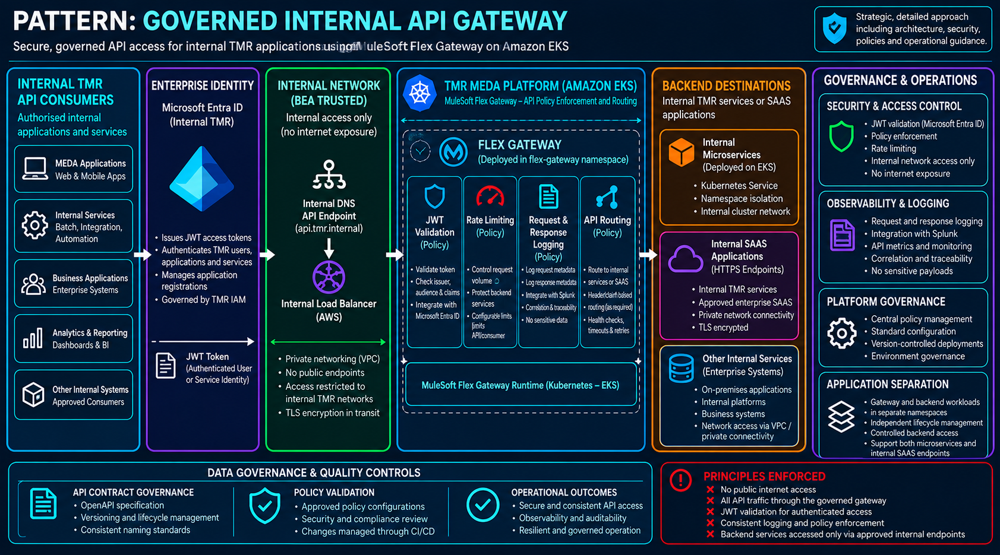

# Governed Internal API Gateway

## 1. Introduction

The **Governed Internal API Gateway** architectural pattern defines how internal TMR applications securely expose, manage and consume APIs through the MEDA platform using MuleSoft Flex Gateway deployed on Amazon Elastic Kubernetes Service (EKS).

The pattern establishes a centrally governed API access layer between authorised internal API consumers and backend services.

It provides:

- Internal API exposure through approved gateway endpoints.
- Centralised API authentication and authorisation controls.
- JWT validation using approved enterprise identity providers.
- API routing to backend services.
- API rate limiting and traffic protection.
- Consistent request and response logging.
- Integration with enterprise observability services.
- Separation between API consumers and backend service implementations.
- Declarative API configuration and deployment through Kubernetes.
- Independent governance of gateway and application workloads.

The architecture uses MuleSoft Flex Gateway as the API policy enforcement and routing capability, with backend services deployed within approved MEDA runtime environments.

**Architectural principle:** Internal applications access backend APIs through a governed gateway boundary that consistently enforces enterprise security, routing, traffic management and observability requirements.

---

## 2. Purpose and Architectural Outcomes

The MEDA platform hosts microservices and APIs supporting TMR business capabilities.

Without a common gateway architecture, individual applications may independently implement:

- Authentication and token validation.
- API routing.
- Rate limiting.
- Request logging.
- Security policy enforcement.
- Consumer access controls.
- Operational monitoring.

This introduces duplicated implementation effort and inconsistent governance across internal APIs.

The Governed Internal API Gateway pattern establishes a standard approach for exposing backend services without requiring each application to independently implement the full set of gateway capabilities.

### 2.1 Architectural Outcomes

The pattern provides:

- A consistent internal API entry point.
- Separation between API access and backend implementation.
- Centralised API policy enforcement.
- Enterprise identity integration.
- Controlled service routing.
- Protection against excessive request traffic.
- Standardised API observability.
- Declarative and repeatable gateway configuration.
- Independent deployment of API gateway and backend services.
- Reduced duplication of API security and management logic.

### 2.2 Core Architectural Decisions

| Decision | Architectural requirement |
|---|---|
| API gateway | MuleSoft Flex Gateway provides the approved gateway capability. |
| Runtime | Flex Gateway is deployed within the approved MEDA EKS environment. |
| Exposure | APIs are accessible only through approved internal TMR network paths. |
| Authentication | Approved JWT validation policies enforce token requirements where applicable. |
| Authorisation | Gateway and backend authorisation responsibilities must be explicitly defined. |
| Routing | Gateway routes direct API requests to approved backend services. |
| Policy enforcement | API security, logging and traffic policies are centrally governed. |
| Observability | API request metrics and logs integrate with approved enterprise monitoring. |
| Configuration | Gateway definitions and policies are maintained as version-controlled deployment artefacts. |
| Backend isolation | Backend services are not unnecessarily exposed directly to API consumers. |

---

## 3. When to Use This Pattern

Use this pattern when an internal TMR application or service must expose an API through the MEDA platform with centrally governed API access controls.

Typical scenarios include:

- Internal microservices exposing REST APIs.
- Enterprise applications consuming MEDA-hosted services.
- Internal APIs requiring JWT validation.
- APIs requiring rate limiting and traffic governance.
- Services requiring consistent operational logging.
- APIs requiring independently managed routing policies.
- Microservices deployed across separate Kubernetes namespaces.
- APIs requiring centralised policy management.

### 3.1 When Not to Use This Pattern

This pattern should not automatically be selected for every internal service interaction.

For example:

- A workload that does not expose an API may not require a gateway.
- Internal service-to-service communication may use an approved direct connectivity model where central gateway controls are not required.
- Public-facing APIs require a separately approved external exposure architecture.
- Asynchronous event distribution should use an appropriate event-driven integration pattern.
- The gateway should not be used to implement backend business logic.

### 3.2 Selection Guidance

| Requirement | Recommended approach |
|---|---|
| Internal REST API exposure | Governed Internal API Gateway |
| Central JWT validation | Flex Gateway JWT validation policy |
| Backend routing | Flex Gateway route policy |
| Request traffic protection | Rate limiting policy |
| Standardised API logging | Approved gateway logging and telemetry policies |
| Backend service discovery | Kubernetes Service or approved backend endpoint |
| External API exposure | Separate approved external API architecture |
| Event-driven integration | Governed event-driven architectural patterns |

---

## 4. Solution Architecture

### 4.1 Logical Architecture

This is a logical representation of the gateway architecture. The policies are enforced as part of request processing rather than separate network hops.

### 4.2 API Gateway Boundary

Flex Gateway provides the controlled boundary between API consumers and backend services.

Its responsibilities include:

- API request acceptance.
- Authentication policy enforcement.
- Configured authorisation checks.
- Traffic management.
- Route selection.
- Request and response observability.
- Forwarding to approved backend destinations.

### 4.3 Backend Services

Backend services are deployed independently of the gateway.

In the supplied reference implementation, the Plates microservice is deployed into a separate Kubernetes namespace and accessed through a Kubernetes Service.

This separation allows gateway configuration and application deployment to be governed independently.

### 4.4 Internal-Only Access

The reference architecture is explicitly internal and not internet-facing.

API access must use approved internal network paths and must not create an unintended public route to the gateway or backend microservices.

---

## 5. Architectural Governance and Tenancy

### 5.1 Gateway Runtime – Amazon EKS

Flex Gateway operates within the approved MEDA Amazon EKS environment.

The reference implementation uses a dedicated gateway namespace containing:

- Flex Gateway runtime components.
- API instance definitions.
- Route policy bindings.
- JWT validation policy bindings.
- Request logging policy bindings.
- Response logging policy bindings.
- Rate limiting policy bindings.
- Gateway service definitions.

The reference namespace is `flex-gateway-imps`.

Namespace naming must follow current MEDA deployment standards.

### 5.2 Application Runtime

Backend applications are deployed into separately governed Kubernetes namespaces.

The reference implementation uses the `plates` namespace for the Plates microservice.

Application teams are responsible for:

- Microservice deployment.
- Application configuration.
- Kubernetes Service definitions.
- Application security.
- Business logic.
- Application-level monitoring.

### 5.3 Gateway Governance

The MEDA platform team governs:

- Approved gateway runtime configurations.
- Gateway policy standards.
- API exposure requirements.
- Security policy configuration.
- Gateway observability.
- Deployment standards.
- Operational support arrangements.

### 5.4 Separation of Responsibilities

The gateway provides shared API management capabilities.

Backend applications remain responsible for business processing, domain authorisation, data access and application correctness.

Gateway authentication does not replace application-level authorisation where business-specific access decisions are required.

---

## 6. API Gateway Configuration Model

The source implementation uses MuleSoft Flex Gateway Kubernetes custom resources to configure API behaviour.

| Component | Responsibility |
|---|---|
| `ApiInstance` | Defines the API instance and listener address. |
| Route `PolicyBinding` | Maps an incoming API route to an approved backend destination. |
| Request logging `PolicyBinding` | Records approved request metadata. |
| Response logging `PolicyBinding` | Records approved response metadata. |
| JWT `PolicyBinding` | Validates configured token properties. |
| Rate limiting `PolicyBinding` | Controls request volume. |
| Flex Gateway `Service` | Defines the backend destination used by the gateway. |
| Kubernetes `Service` | Provides network access to the backend application. |
| Kubernetes `Deployment` | Runs the backend application workload. |

The exact custom resource definitions and policy configuration must match the supported Flex Gateway version and deployment mode.

### 6.1 API Instance

Each managed API requires an approved API instance definition.

The source implementation uses the following naming approach:

`<api-name>-<domain>-<version>`

For example:

`plates-api-imps-v1`

### 6.2 Route Definition

API routes must explicitly define:

- Target API instance.
- Incoming path.
- Destination service.
- Destination path where required.
- Route evaluation order where applicable.

### 6.3 Policy Binding

Policies must be associated with the intended API instance.

Policy execution order and interactions must be validated to ensure security and traffic controls are applied correctly.

---

## 7. API Routing and Backend Connectivity

### 7.1 Request Routing

Flex Gateway receives requests at an approved API listener and routes them to a configured backend service.

The source implementation demonstrates routing from the Plates API to a Spring Boot microservice.

### 7.2 Kubernetes Service Discovery

Where the backend runs on EKS, the gateway may use Kubernetes DNS to resolve the destination service.

Example:

`http://plates-service.plates.svc.cluster.local:8081/`

The destination must be reachable through approved Kubernetes networking and security controls.

### 7.3 Namespace Separation

The gateway and backend application may operate in different Kubernetes namespaces.

The architecture must define:

- Service naming.
- Namespace ownership.
- Allowed network connectivity.
- Service ports.
- Destination health.
- Deployment dependencies.

### 7.4 Backend Protection

Backend services should not expose unnecessary alternative entry points that bypass required gateway policies.

Any direct access must be explicitly approved and governed.

---

## 8. API Authentication and JWT Validation

### 8.1 Enterprise Identity Integration

The source implementation uses Microsoft Entra ID, previously Azure Active Directory, as the token issuer for internal API authentication.

Flex Gateway validates JWTs using a configured policy and the identity provider's published signing keys.

### 8.2 JWT Validation Requirements

Applicable controls include:

- Token signature validation.
- Approved signing algorithms.
- Issuer validation.
- Audience validation.
- Token expiration.
- Not-before validation.
- Required claims.
- Signing-key retrieval and rotation.

The exact supported controls depend on the gateway policy version and configuration.

### 8.3 JWKS Integration

The gateway may retrieve signing keys from an approved JWKS endpoint.

The implementation must define:

- Approved identity tenant.
- JWKS endpoint.
- Key caching.
- Timeout behaviour.
- Key rotation handling.
- Failure behaviour.

### 8.4 Authentication and Authorisation Separation

A valid JWT establishes that the token satisfies configured authentication requirements.

It does not automatically establish that the caller is authorised to perform every business operation.

Business-specific permissions must be enforced through appropriate gateway or application controls.

### 8.5 Token Security

Access tokens and client secrets must not be written into operational logs or embedded in deployment manifests.

Credentials must be managed using approved secret-management mechanisms.

---

## 9. API Rate Limiting and Traffic Governance

### 9.1 Purpose

Rate limiting protects backend services against excessive or unexpected request traffic.

### 9.2 Policy Configuration

Rate limiting policies must define:

- Maximum request count.
- Evaluation period.
- Request grouping or key selection.
- Policy scope.
- Distributed enforcement behaviour where supported.
- Response behaviour when limits are exceeded.

### 9.3 Consumer-Aware Limits

Where required, limits should distinguish between consumers or applications rather than relying solely on HTTP methods.

The selected key must align with the required fairness and protection model.

### 9.4 Capacity Planning

Rate limits must be assessed against:

- Expected traffic.
- Backend capacity.
- Peak usage.
- Availability requirements.
- Consumer behaviour.
- Retry patterns.

The Plates example uses a specific request limit for demonstration purposes. That value is not an enterprise-wide standard.

---

## 10. Request and Response Logging

### 10.1 Purpose

Flex Gateway provides a consistent mechanism for capturing API request and response metadata.

The source implementation integrates gateway logs with Splunk.

### 10.2 Logging Requirements

Logging should capture approved metadata such as:

- API name.
- API version.
- Environment.
- Request method.
- Request path.
- Response status.
- Request timestamp.
- Correlation identifier.
- Processing duration where available.
- Consumer or application identity where permitted.

### 10.3 Request Logging

Request logging must support operational troubleshooting and API usage analysis without unnecessarily exposing sensitive information.

### 10.4 Response Logging

Response logging must provide visibility into API outcomes, including errors and response status.

### 10.5 Sensitive Data Protection

The implementation must avoid logging:

- Access tokens.
- Client secrets.
- Sensitive request bodies.
- Sensitive response bodies.
- Unnecessary personal information.

### 10.6 Logging Contract Governance

The original implementation contains a structured logging expression used by IMPS Splunk analytics.

Changes to an established logging contract must be coordinated with the teams responsible for log ingestion, parsing and dashboards.

The specific logging expression belongs in the implementation reference rather than the reusable architectural pattern.

---

## 11. API Policy Governance

### 11.1 Central Policy Management

API policies must be maintained using approved platform configuration and deployment processes.

### 11.2 Policy Categories

Typical policy categories include:

- Authentication.
- Authorisation.
- Routing.
- Rate limiting.
- Request logging.
- Response logging.
- Additional security controls where supported.

### 11.3 Policy Ordering

The architecture must define and validate the required order of policy execution.

Security-sensitive policies must not be unintentionally bypassed because of routing or policy configuration.

### 11.4 Policy Consistency

Common policies should follow approved MEDA standards.

API-specific variations must be justified by application requirements.

---

## 12. Kubernetes Deployment and Configuration

### 12.1 Declarative Configuration

Gateway configuration is represented through version-controlled Kubernetes deployment artefacts.

These may include:

- API instance definitions.
- Policy bindings.
- Backend destination definitions.
- Kubernetes Service resources.
- Kubernetes Deployment resources.

### 12.2 Deployment Automation

Gateway and application configuration should be deployed through approved CI/CD processes.

Deployment automation must support:

- Configuration validation.
- Environment-specific settings.
- Controlled promotion.
- Rollback.
- Auditability.
- Separation of duties.

### 12.3 Environment Configuration

Environment-specific values must not be unnecessarily hard-coded into reusable deployment templates.

Examples include:

- Hostnames.
- Identity tenant information.
- Backend destinations.
- Logging settings.
- Rate limits.
- API versions.

### 12.4 Runtime Compatibility

Gateway custom resources and policies must be validated against the installed Flex Gateway runtime and controller versions.

---

## 13. API Versioning and Lifecycle Management

### 13.1 API Identity

Each API must have a clearly defined identity and version.

The reference implementation includes the API name, domain and version in its resource names.

### 13.2 API Versioning

API versions must follow approved MEDA standards.

Version changes must consider:

- Consumer compatibility.
- Routing changes.
- Policy configuration.
- Backend deployment.
- Deprecation.
- Retirement.

### 13.3 API Contract Management

Where applicable, APIs must maintain an approved OpenAPI specification.

The API contract should describe:

- Resources and operations.
- Request and response schemas.
- Authentication requirements.
- Error responses.
- Versioning.
- Consumer expectations.

### 13.4 API Retirement

Retired APIs must have their routes, policies and related configuration removed through controlled deployment processes.

---

## 14. Resiliency and Availability

### 14.1 Gateway Availability

Gateway deployment must meet the availability requirements of the APIs it manages.

### 14.2 Backend Availability

Backend services must independently define:

- Replica requirements.
- Readiness and liveness checks.
- Scaling.
- Resource limits.
- Recovery behaviour.

### 14.3 Failure Isolation

A failure in one backend application should not unnecessarily affect unrelated APIs.

### 14.4 Timeouts and Retries

The solution must define appropriate:

- Connection timeouts.
- Request timeouts.
- Retry behaviour.
- Upstream error handling.

Retries must be assessed for duplicate business operations.

### 14.5 Rate Limiting and Capacity

Gateway capacity and rate limiting must be aligned with backend service capacity and expected traffic.

---

## 15. Observability and Operational Monitoring

### 15.1 Gateway Monitoring

Relevant operational metrics include:

- Request volume.
- Response status distribution.
- API latency.
- Authentication failures.
- Rate-limit violations.
- Backend connectivity failures.
- Gateway runtime health.

### 15.2 Application Monitoring

Backend services must expose appropriate application-level monitoring independently of gateway telemetry.

### 15.3 Correlation and Traceability

Requests should carry an approved correlation identifier to support end-to-end tracing.

Where supported, distributed tracing should connect:

- API consumer.
- Gateway.
- Backend service.
- Downstream dependencies.

### 15.4 Operational Ownership

The platform team and application teams must have clearly defined support responsibilities.

---

## 16. Security and Data Protection

### 16.1 Internal Network Boundary

Gateway endpoints must be exposed only through approved internal TMR connectivity.

### 16.2 Least-Privilege Access

Gateway, application and operational identities must receive only the permissions required for their responsibilities.

### 16.3 Transport Security

TLS must be applied according to approved security requirements.

Encryption requirements must be assessed across both consumer-to-gateway and gateway-to-backend connections.

### 16.4 Token Validation

JWT validation must enforce the approved authentication and token requirements.

### 16.5 Backend Security

Backend services remain responsible for domain authorisation, input validation and protection of business data.

### 16.6 Configuration Security

Gateway policies and deployment artefacts must not contain embedded secrets.

---

## 17. Architecture Implementation Checklist

Before adopting this pattern, the solution architect must confirm the following.

| Area | Required assessment |
|---|---|
| API exposure | Is the API intended for internal TMR consumption? |
| Gateway selection | Is Flex Gateway the approved gateway capability? |
| Runtime | Is the approved EKS environment identified? |
| Connectivity | Are internal network paths defined? |
| API identity | Are API name and version defined? |
| Backend | Is the backend service and destination identified? |
| Routing | Are paths and destination mappings documented? |
| Authentication | Is the approved identity provider configured? |
| JWT validation | Are issuer, audience, signature and expiry controls defined? |
| Authorisation | Are business permissions enforced appropriately? |
| Rate limiting | Are request limits aligned with capacity requirements? |
| Logging | Are approved request and response logging policies configured? |
| Sensitive data | Are secrets and sensitive payloads protected? |
| Deployment | Are configuration artefacts version-controlled? |
| Policy order | Has policy execution been validated? |
| Resilience | Are gateway and backend failure behaviours defined? |
| Observability | Are logs, metrics and alerts available? |
| Operations | Are support responsibilities assigned? |
| API lifecycle | Are versioning and retirement processes defined? |

---

## 18. The Governed API Outcome

The Governed Internal API Gateway establishes a standard approach for exposing and managing internal APIs within the MEDA platform.

The architecture ensures:

- Controlled internal API exposure.
- Consistent authentication and policy enforcement.
- Governed backend routing.
- Traffic protection.
- Centralised API logging.
- Enterprise observability.
- Independent backend deployment.
- Repeatable configuration.
- Clear operational ownership.
- Reduced duplication of gateway responsibilities.

**Final architectural principle:**

> Internal APIs are exposed through a governed gateway boundary that separates enterprise access controls and traffic management from backend business processing.

---

## 19. Related Architectural Patterns

### Governed Multi-Protocol Integration Layer

The Governed Multi-Protocol Integration Layer defines how applications and systems publish events into the MEDA Event Backbone through approved Kafka-native and platform-mediated ingestion mechanisms.

It is applicable when an API-based integration results in asynchronous event publication.

### Governed Private Event Processing

Governed Private Event Processing defines how enterprise events are securely processed, enriched and consumed within the trusted MEDA streaming environment.

It may complement an API implementation that produces or consumes Kafka events.

### Related Architectural Capabilities

This pattern may also be used alongside architectural guidance for:

- Microservice deployment on Amazon EKS.
- API contract governance.
- Enterprise identity and access management.
- Kubernetes networking.
- CI/CD deployment.
- API observability.
- Event-driven microservices.

---

## 20. Pattern Classification

**Architectural pattern:** Governed Internal API Gateway

**Category:** API and Integration Architecture

**Enterprise asset identifier:**

`pattern/governed-internal-api-gateway`

**Applicability:** Internal TMR API exposure and governance through MuleSoft Flex Gateway on Amazon EKS.

**Primary capabilities:**

- API routing.
- JWT validation.
- Gateway policy enforcement.
- Rate limiting.
- Request and response logging.
- Backend service integration.
- Kubernetes-based gateway configuration.
- Internal network isolation.
- Enterprise API observability.

The stable identifier is defined by the YAML front matter and does not depend on the repository directory or category.

The pattern is reusable across MEDA internal API solutions and does not prescribe Plates-specific API names, namespaces, service endpoints or application implementations.