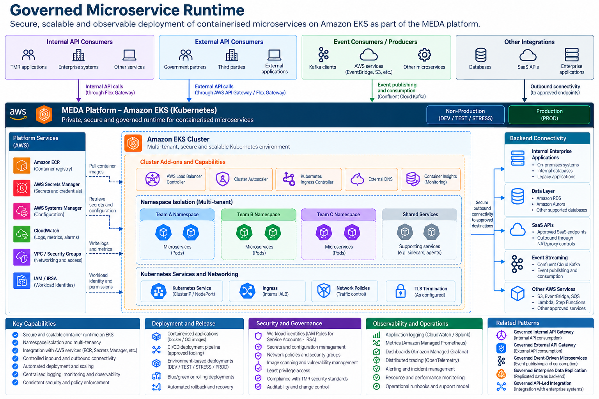
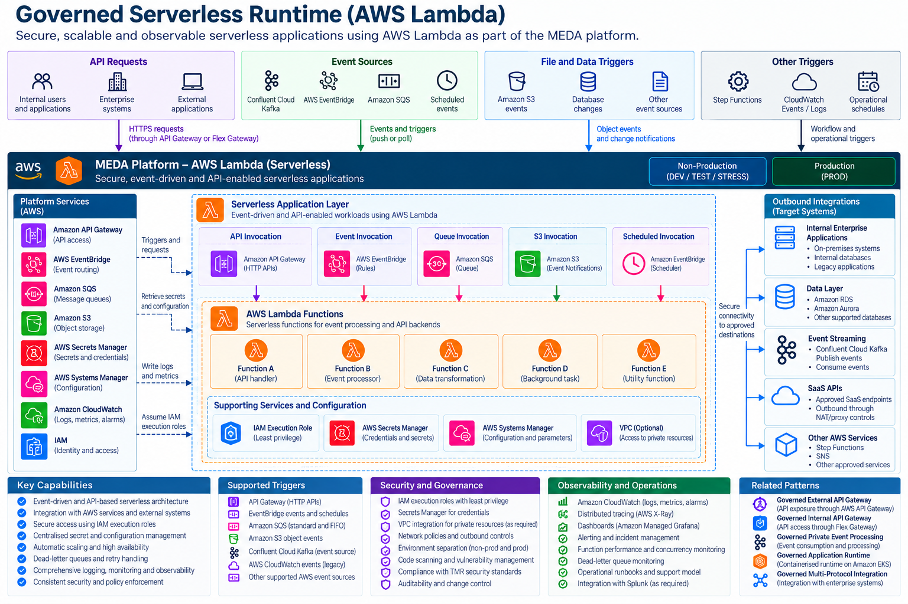

# Governed Application Runtime

## 1. Introduction

The **Governed Application Runtime** architectural pattern defines how applications and business services are securely deployed, executed, scaled and operated within the TMR MEDA platform using approved AWS compute capabilities.

The pattern establishes a consistent enterprise governance model across two application runtime architectures:

- **Containerised Runtime — Amazon Elastic Kubernetes Service (EKS)**
- **Serverless Runtime — AWS Lambda**

Both runtime models enable TMR application teams to deliver business capabilities while maintaining consistent security, identity, networking, deployment and operational governance.

The pattern supports:

- Containerised microservices and application workloads.
- Event-driven and API-enabled serverless functions.
- Secure integration with internal enterprise systems.
- Integration with approved SaaS APIs.
- API exposure through governed MEDA gateway architectures.
- Event processing using approved event sources.
- Centralised identity and access management.
- Secure configuration and secrets management.
- Automated deployment through approved CI/CD pipelines.
- Application scaling and availability.
- Enterprise logging, monitoring and observability.
- Separation between non-production and production environments.

**Architectural principle:** Applications must execute within an approved, governed runtime environment, with security, connectivity, identity, deployment and observability controls applied consistently regardless of the underlying compute model.

---

## 2. Purpose and Architectural Outcomes

TMR applications require different execution models depending on their workload characteristics.

Some workloads require continuously running services, container orchestration and fine-grained runtime control.

Other workloads are better suited to event-triggered execution, short-lived processing or managed serverless infrastructure.

Mandating a single compute model for every application would introduce unnecessary complexity, cost and operational overhead.

The Governed Application Runtime pattern establishes a common architecture that supports both Amazon EKS and AWS Lambda while maintaining consistent enterprise controls.

### 2.1 Architectural Outcomes

The pattern provides:

- Standardised application hosting within MEDA.
- Clear selection criteria between containerised and serverless runtimes.
- Consistent identity and access governance.
- Secure application connectivity.
- Centralised secrets and configuration management.
- Automated, repeatable deployments.
- Runtime scalability and resilience.
- Environment isolation.
- Standardised operational telemetry.
- Reduced duplication of infrastructure and security design.
- Support for both synchronous and asynchronous application workloads.

### 2.2 Core Architectural Decisions

| Decision | Architectural requirement |
|---|---|
| Runtime selection | EKS or Lambda must be selected according to workload requirements. |
| Containerised runtime | Amazon EKS provides the approved Kubernetes application runtime. |
| Serverless runtime | AWS Lambda provides the approved function execution capability. |
| API exposure | APIs use the applicable governed internal or external API gateway architecture. |
| Identity | Workloads use approved AWS IAM identities and least-privilege permissions. |
| Secrets | Sensitive credentials are managed through approved secret-management services. |
| Configuration | Environment-specific configuration is externally managed. |
| Networking | Applications use approved private networking and controlled outbound connectivity. |
| Deployment | Infrastructure and application deployments use approved CI/CD processes. |
| Observability | Logs, metrics and operational telemetry integrate with enterprise monitoring. |
| Environment separation | Non-production and production workloads remain independently governed. |
| Backend integration | Applications connect only to approved enterprise, data and SaaS destinations. |

---

## 3. When to Use This Pattern

Use this pattern when a TMR application or integration workload requires execution within the MEDA AWS platform.

Typical scenarios include:

- Hosting internal business microservices.
- Deploying API backend services.
- Processing asynchronous business events.
- Running scheduled integration workloads.
- Processing S3 object notifications.
- Executing background application tasks.
- Implementing lightweight data transformations.
- Integrating with enterprise applications.
- Invoking approved SaaS APIs.
- Building event-driven application components.

### 3.1 Runtime Selection Guidance

| Requirement | Amazon EKS | AWS Lambda |
|---|---|---|
| Continuously running services | Preferred where Kubernetes hosting is appropriate | Not generally suitable for continuously running processes |
| Container orchestration | Native Kubernetes capability | Not applicable |
| Event-triggered execution | Supported through application consumers | Native execution model |
| Short-lived processing | Supported | Often preferred |
| Long-running processing | Suitable within workload and platform constraints | Limited by maximum invocation duration |
| Fine-grained runtime control | Greater control | Managed execution environment |
| Scaling | Kubernetes workload scaling | Lambda concurrency scaling |
| API backends | Supported | Supported |
| Kafka consumption | Suitable for continuously running consumers | Supported through compatible event source mappings |
| Scheduled workloads | Kubernetes CronJobs or approved schedulers | EventBridge Scheduler or approved event sources |
| Infrastructure management | Requires Kubernetes workload operations | Reduced server management |
| Cost model | Cluster and workload capacity | Primarily invocation and execution consumption |

### 3.2 When Not to Use This Pattern

This pattern should not automatically be selected when:

- The requirement can be satisfied by an existing MEDA platform capability without new application code.
- A managed integration or replication service is more appropriate.
- The workload requires capabilities not supported by the selected runtime.
- An application would unnecessarily duplicate an existing enterprise service.
- The solution requires an unapproved public endpoint or network path.

---

## 4. Solution Architecture

The pattern contains two reference architectures.

Both use the same enterprise governance principles but represent different compute and operational models.

### 4.1 Reference Architecture A — Governed Containerised Runtime (Amazon EKS)



The Amazon EKS reference architecture supports containerised applications and microservices deployed into approved Kubernetes environments.

The architecture includes:

- Amazon EKS.
- Kubernetes namespaces.
- Application deployments and pods.
- Kubernetes Services.
- Amazon Elastic Container Registry (ECR).
- Approved ingress and API gateway integration.
- IAM workload identities.
- AWS Secrets Manager.
- AWS Systems Manager Parameter Store.
- Kubernetes networking and security controls.
- Application autoscaling.
- Enterprise observability.
- CI/CD deployment automation.

#### Logical Architecture

```text
                  INTERNAL / EXTERNAL
                     API CONSUMERS
                           |
                           v
                  GOVERNED API GATEWAY
                           |
                           v
                    INTERNAL ROUTING
                           |
                           v
                    AMAZON EKS CLUSTER
                           |
                 +---------+---------+
                 |                   |
                 v                   v
          Application A         Application B
           Namespace             Namespace
                 |                   |
                 v                   v
          Kubernetes Pods      Kubernetes Pods
                 |                   |
                 +---------+---------+
                           |
                           v
                   APPROVED SERVICES
                           |
            +--------------+--------------+
            |              |              |
            v              v              v
         Databases     Event Streaming   SaaS APIs
```

The diagram represents a logical application runtime architecture. Actual API exposure, networking and service connectivity must follow approved MEDA designs.

### 4.2 Reference Architecture B — Governed Serverless Runtime (AWS Lambda)



The AWS Lambda reference architecture supports event-driven, scheduled and API-enabled application workloads without requiring application teams to manage servers or Kubernetes clusters.

The architecture includes:

- AWS Lambda.
- Amazon API Gateway.
- Amazon EventBridge.
- Amazon SQS.
- Amazon S3 event notifications.
- Approved Kafka event sources.
- AWS IAM execution roles.
- AWS Secrets Manager.
- AWS Systems Manager Parameter Store.
- Amazon CloudWatch.
- Optional VPC integration.
- Approved outbound enterprise and SaaS connectivity.

#### Logical Architecture

```text
                    APPLICATION TRIGGERS
                            |
          +-----------------+------------------+
          |                 |                  |
          v                 v                  v
      API Gateway       EventBridge         Amazon SQS
          |                 |                  |
          +-----------------+------------------+
                            |
                            v
                        AWS LAMBDA
                            |
               +------------+------------+
               |            |            |
               v            v            v
             IAM         Secrets      Configuration
          Execution      Manager       Parameter
             Role                        Store
                            |
                            v
                    BUSINESS PROCESSING
                            |
          +-----------------+------------------+
          |                 |                  |
          v                 v                  v
     Enterprise          Databases         Confluent
     Applications                           Kafka
          |
          v
     Approved SaaS
       APIs
```

The logical diagram illustrates common runtime dependencies. AWS Lambda functions may use different combinations of triggers and integrations depending on the solution.

### 4.3 Common Governance Model

Both architectures must comply with:

- Enterprise identity and access controls.
- Approved network connectivity.
- Secrets and configuration governance.
- Environment isolation.
- Infrastructure-as-code standards.
- CI/CD deployment controls.
- Application security requirements.
- Operational monitoring.
- Auditability.
- Application ownership.

---

## 5. Architectural Governance and Tenancy

### 5.1 MEDA AWS Environment

Application runtimes operate within approved TMR AWS accounts and environments.

The architecture must maintain appropriate separation between:

- Development.
- Test.
- Stress and performance testing.
- Production.

Environment boundaries must be enforced through account, network, identity and deployment controls as applicable.

### 5.2 Amazon EKS Governance

The EKS runtime provides a centrally managed Kubernetes environment.

Governance responsibilities include:

- Cluster lifecycle.
- Kubernetes version management.
- Node and compute configuration.
- Namespace standards.
- Network policies.
- Workload identity.
- Resource quotas.
- Application deployment controls.
- Runtime monitoring.

### 5.3 AWS Lambda Governance

The Lambda runtime provides managed function execution.

Governance responsibilities include:

- Function configuration.
- Runtime version.
- Execution role.
- Event source configuration.
- Timeout and memory settings.
- Concurrency limits.
- VPC integration where required.
- Deployment and version management.
- Monitoring and alerting.

### 5.4 Separation of Responsibilities

| Responsibility | MEDA platform team | Application team |
|---|---|---|
| Approved runtime architecture | Owns standards | Adopts standards |
| AWS account and platform controls | Governs | Complies |
| EKS cluster infrastructure | Manages | Consumes |
| Lambda platform guardrails | Governs | Configures functions |
| Application code | Supports deployment standards | Owns |
| Application IAM permissions | Defines guardrails | Requests and maintains required permissions |
| Application configuration | Provides approved mechanisms | Owns values and lifecycle |
| Application observability | Provides integration standards | Implements telemetry |
| Business logic and data | Not generally responsible | Owns |

---

## 6. Containerised Runtime — Amazon EKS

### 6.1 Application Deployment

Containerised workloads are deployed to Amazon EKS using approved Kubernetes deployment resources.

Typical resources include:

- Deployments.
- Pods.
- Services.
- ConfigMaps.
- Secrets references.
- Service accounts.
- Horizontal Pod Autoscalers.
- Network policies.

### 6.2 Container Image Management

Application container images must be built and stored in approved image registries such as Amazon ECR.

Controls include:

- Image versioning.
- Vulnerability scanning.
- Approved base images.
- Dependency management.
- Immutable release artefacts.
- Controlled promotion.

### 6.3 Namespace Isolation

Applications must use approved namespace boundaries.

Namespace governance should address:

- Ownership.
- Resource quotas.
- Access permissions.
- Network isolation.
- Deployment permissions.
- Monitoring.

### 6.4 Service Discovery

Applications may communicate through approved Kubernetes Services and internal DNS.

Direct pod addressing should not be relied upon as a stable application integration mechanism.

### 6.5 Workload Scaling

Scaling may use:

- Horizontal Pod Autoscaling.
- Cluster or node autoscaling.
- Appropriate workload resource limits.
- Application-specific scaling controls.

### 6.6 Application Health

Containerised workloads must implement appropriate:

- Readiness probes.
- Liveness probes.
- Startup probes where required.
- Graceful shutdown behaviour.

---

## 7. Serverless Runtime — AWS Lambda

### 7.1 Function Execution Model

AWS Lambda executes application code in response to configured invocations or event sources.

Typical use cases include:

- API backend operations.
- Event processing.
- Scheduled tasks.
- S3 object processing.
- Queue processing.
- Integration automation.
- Lightweight data transformations.

### 7.2 Function Configuration

Each function must define:

- Runtime and version.
- Execution role.
- Memory allocation.
- Timeout.
- Environment configuration.
- Event sources.
- Concurrency requirements.
- Logging.
- Error handling.

### 7.3 Event Source Integration

Supported invocation mechanisms may include:

- Amazon API Gateway.
- Amazon EventBridge.
- Amazon SQS.
- Amazon S3.
- Compatible Kafka event sources.
- AWS Step Functions.
- Approved AWS services.

### 7.4 Execution Constraints

Lambda workloads must be designed around managed function execution characteristics.

Considerations include:

- Maximum invocation duration.
- Stateless execution assumptions.
- Cold-start behaviour.
- Concurrency limits.
- Payload size limits.
- Event source retry behaviour.
- Temporary storage requirements.

### 7.5 Idempotency

Event-driven functions must account for duplicate delivery and retry scenarios.

Where required, processing must be idempotent to prevent repeated business operations.

### 7.6 Function Versioning

Production deployments should use approved function versioning and deployment mechanisms.

These may include:

- Published versions.
- Aliases.
- Controlled traffic shifting.
- Rollback.

---

## 8. API Exposure and Application Connectivity

### 8.1 Governed API Exposure

Applications requiring API access must use the applicable MEDA gateway architecture.

The approved pattern depends on the consumer:

- Internal TMR consumers use the **Governed Internal API Gateway**.
- External consumers use the **Governed External API Gateway**.

### 8.2 EKS API Backends

Flex Gateway may route requests to approved Kubernetes Services hosting application workloads.

### 8.3 Lambda API Backends

Lambda functions may be invoked through approved API integration mechanisms.

The design must establish how the API is exposed and how required MEDA API policies are enforced.

The use of Lambda does not automatically authorise a separate public API endpoint that bypasses approved gateway governance.

### 8.4 Internal Enterprise Connectivity

Applications may connect to approved internal enterprise services using governed network paths.

### 8.5 SaaS Connectivity

Applications may integrate with approved SaaS APIs.

The design must address:

- Outbound connectivity.
- Authentication.
- TLS.
- Credential handling.
- Timeouts.
- Rate limits.
- Data classification.

---

## 9. Event-Driven Application Integration

### 9.1 Event Sources

Application runtimes may consume events from approved event sources.

Examples include:

- Confluent Cloud Kafka.
- Amazon EventBridge.
- Amazon SQS.
- Amazon S3 notifications.
- Scheduled events.

### 9.2 EKS Event Consumers

Containerised applications may implement continuously running Kafka consumers or other event-processing workloads.

### 9.3 Lambda Event Consumers

Lambda may process events through supported event source mappings or direct invocation integrations.

### 9.4 Event Processing Requirements

Applications must address:

- Event contracts.
- Delivery semantics.
- Idempotency.
- Ordering requirements.
- Retry behaviour.
- Poison messages.
- Dead-letter handling.
- Replay.
- Consumer ownership.

### 9.5 Event Publication

Applications publishing events into the MEDA Event Backbone must comply with the Governed Multi-Protocol Integration Layer and applicable event contract requirements.

---

## 10. Identity and Access Governance

### 10.1 Enterprise Identity

Application workloads must use approved workload identities rather than shared or embedded credentials.

### 10.2 EKS Workload Identity

EKS workloads must use an approved AWS IAM integration mechanism, such as:

- IAM Roles for Service Accounts.
- EKS Pod Identity, where supported and approved.

Permissions must be scoped to the application's requirements.

### 10.3 Lambda Execution Roles

Each Lambda function must use an IAM execution role with least-privilege permissions.

Execution roles must not grant broad access to unrelated AWS services or resources.

### 10.4 Service-to-Service Identity

Applications calling other services must use the required authentication mechanism for the destination.

### 10.5 Access Governance

Identity design must distinguish:

- Application runtime identity.
- Deployment identity.
- Operational administrator identity.
- API consumer identity.
- Backend integration identity.

### 10.6 Least Privilege

Access must be limited to the resources and operations required for the application.

---

## 11. Secrets and Configuration Management

### 11.1 AWS Secrets Manager

Sensitive application credentials must be stored using approved secret-management capabilities.

Examples include:

- Database credentials.
- SaaS API credentials.
- Client secrets.
- Integration authentication material.

### 11.2 AWS Systems Manager Parameter Store

Non-sensitive application configuration may be managed through Parameter Store or another approved configuration mechanism.

### 11.3 EKS Configuration

EKS workloads may consume configuration through approved Kubernetes and AWS integration mechanisms.

Sensitive values must not be committed into source repositories or embedded in container images.

### 11.4 Lambda Configuration

Lambda functions may use environment variables for appropriate configuration values.

Sensitive credentials should be retrieved or securely referenced through approved secret-management services.

### 11.5 Environment Isolation

Production credentials must remain separate from non-production credentials.

### 11.6 Credential Rotation

The solution must support credential rotation and access revocation where required.

---

## 12. Networking and Security Boundaries

### 12.1 EKS Networking

EKS workloads operate within approved AWS VPC networking.

Controls may include:

- Private subnets.
- Security groups.
- Kubernetes network policies.
- Internal load balancers.
- Approved ingress and egress paths.

### 12.2 Lambda Networking

Lambda functions do not automatically require VPC attachment.

VPC integration must be configured when required to access approved private resources or satisfy the solution's network controls.

### 12.3 Outbound Connectivity

Application access to external services must follow approved egress controls.

### 12.4 Public Exposure

Application workloads must not independently expose unmanaged public endpoints.

Public API access must use the applicable governed external API architecture.

### 12.5 Encryption

Applications must use approved encryption controls for data in transit and at rest.

### 12.6 Runtime Isolation

Security boundaries must prevent unnecessary access between applications, environments and business domains.

---

## 13. Application Deployment and CI/CD

### 13.1 Source Control

Application source code and infrastructure configuration must be maintained in approved version-control repositories.

### 13.2 Deployment Automation

Deployments must use approved CI/CD pipelines.

For MEDA, GitHub Actions and Terraform may be used where consistent with platform standards.

### 13.3 Infrastructure as Code

Infrastructure configuration should be declarative and version-controlled.

Examples include:

- EKS workload configuration.
- Lambda function configuration.
- IAM roles.
- Event source mappings.
- Network configuration.
- Monitoring resources.

### 13.4 Containerised Deployment

EKS deployment processes must support:

- Container image build.
- Security scanning.
- Registry publication.
- Kubernetes deployment.
- Health validation.
- Rollback.

### 13.5 Serverless Deployment

Lambda deployment processes must support:

- Function packaging.
- Dependency management.
- Configuration validation.
- Version publication.
- Controlled release.
- Rollback.

### 13.6 Environment Promotion

Changes must be promoted through approved environment controls.

Production deployments must be subject to appropriate approval and audit requirements.

---

## 14. Scaling and Performance

### 14.1 EKS Scaling

Containerised workloads must define:

- Resource requests.
- Resource limits.
- Replica requirements.
- Autoscaling configuration.
- Expected throughput.
- Application capacity.

### 14.2 Lambda Scaling

Lambda workloads must define:

- Expected invocation volume.
- Concurrency requirements.
- Memory allocation.
- Timeout.
- Event source scaling behaviour.
- Downstream service limits.

### 14.3 Downstream Protection

Scaling must not overwhelm downstream systems.

Controls may include:

- Rate limiting.
- Concurrency limits.
- Queue buffering.
- Backpressure.
- Retry policies.

### 14.4 Performance Testing

Solutions must validate:

- Expected throughput.
- Peak load.
- Response time.
- Event processing latency.
- Resource consumption.
- Downstream capacity.

### 14.5 Cost Considerations

Runtime selection should account for workload characteristics and total operating cost.

EKS and Lambda have different capacity, scaling and billing models.

The lowest infrastructure cost is not necessarily the lowest overall solution cost.

---

## 15. Resiliency and Failure Handling

### 15.1 EKS Availability

Containerised applications must define:

- Replica availability.
- Health checks.
- Deployment recovery.
- Restart behaviour.
- Failure isolation.

### 15.2 Lambda Availability

Serverless applications must define:

- Invocation failure handling.
- Timeout behaviour.
- Retry configuration.
- Concurrency management.
- Event source recovery.

### 15.3 Dead-Letter Handling

Asynchronous workloads must define how failed or unprocessable events are handled.

Depending on the event source, this may involve:

- Dead-letter queues.
- Failure destinations.
- Retry policies.
- Quarantine processing.

### 15.4 Idempotency

Retryable operations must avoid unintended duplicate business effects.

### 15.5 Recovery Objectives

Applications must define applicable:

- Recovery Time Objectives.
- Recovery Point Objectives.
- Availability requirements.
- Data durability requirements.

### 15.6 Failure Isolation

Failure of one application workload should not unnecessarily affect unrelated workloads or shared platform services.

---

## 16. Observability and Operational Monitoring

### 16.1 Common Observability Requirements

All application runtimes must provide appropriate:

- Logs.
- Metrics.
- Alerts.
- Correlation identifiers.
- Error reporting.
- Operational dashboards.

### 16.2 EKS Observability

EKS workloads may integrate with:

- Amazon CloudWatch.
- Amazon Managed Service for Prometheus.
- Amazon Managed Grafana.
- Splunk Cloud.
- Approved distributed tracing capabilities.

### 16.3 Lambda Observability

Lambda functions may integrate with:

- Amazon CloudWatch Logs.
- CloudWatch metrics and alarms.
- AWS X-Ray or approved tracing.
- Enterprise monitoring and alerting.

### 16.4 Distributed Tracing

Where applicable, applications should support tracing across:

- API gateways.
- EKS services.
- Lambda functions.
- Event sources.
- Backend services.
- Data platforms.

### 16.5 Operational Ownership

Each application must have an identified owner responsible for:

- Service health.
- Incident response.
- Monitoring.
- Support.
- Application recovery.
- Runtime configuration.
- Lifecycle management.

---

## 17. Architecture Implementation Checklist

Before adopting this pattern, the solution architect must confirm the following.

| Area | Required assessment |
|---|---|
| Business requirement | What capability will the application provide? |
| Runtime selection | Is EKS or Lambda the appropriate compute model? |
| Workload characteristics | Is execution continuous, event-driven, scheduled or request-based? |
| Environment | Is the approved AWS account and environment identified? |
| Ownership | Is the application owner defined? |
| API exposure | Is the applicable internal or external API gateway pattern selected? |
| Event integration | Are approved event sources and contracts identified? |
| EKS configuration | Are namespaces, Services, workloads and resource limits defined? |
| Lambda configuration | Are runtime, timeout, memory and concurrency defined? |
| Identity | Are approved workload identities configured? |
| Secrets | Are sensitive credentials centrally managed? |
| Configuration | Are environment-specific settings externalised? |
| Networking | Are ingress, egress and private connectivity requirements defined? |
| Backend integration | Are destination systems approved? |
| Security | Are least privilege, encryption and isolation addressed? |
| CI/CD | Are deployments automated and version-controlled? |
| Scaling | Are capacity and performance requirements defined? |
| Resilience | Are failure handling and recovery requirements defined? |
| Observability | Are logs, metrics, alerts and tracing available? |
| Operations | Are support and incident responsibilities assigned? |
| Cost | Has runtime cost been assessed? |
| Lifecycle | Are upgrade, deployment and retirement processes defined? |

---

## 18. The Governed Application Runtime Outcome

The Governed Application Runtime pattern establishes a reusable architecture for hosting and operating enterprise applications within MEDA.

The architecture ensures:

- Consistent application governance.
- Clear runtime selection.
- Secure workload identities.
- Approved network connectivity.
- Centralised secrets and configuration management.
- Repeatable deployment.
- Controlled scaling.
- Operational resilience.
- Enterprise observability.
- Environment separation.
- Integration with approved MEDA capabilities.

The pattern enables architects to select the most appropriate compute model without compromising enterprise security or operational standards.

**Final architectural principle:**

> Application workloads may execute using different compute models, but must remain subject to consistent enterprise governance for identity, security, connectivity, deployment, resilience and observability.

---

## 19. Related Architectural Patterns

### Governed Internal API Gateway

Defines how internal TMR applications securely access APIs through MuleSoft Flex Gateway.

This pattern applies when an EKS or Lambda workload exposes an API for internal consumption.

### Governed External API Gateway

Defines how external consumers securely access approved TMR APIs through AWS API Gateway, private integration and MuleSoft Flex Gateway.

This pattern applies when an application requires external API exposure.

### Governed Multi-Protocol Integration Layer

Defines how Kafka-native and non-Kafka systems publish data into the MEDA Event Backbone through approved ingestion mechanisms.

This pattern applies when application workloads publish events into Kafka.

### Governed Private Event Processing

Defines how trusted event streams are processed, enriched and persisted within the MEDA platform.

It may complement application workloads that produce or consume processed events.

### Governed Enterprise Data Replication

Defines how enterprise data is replicated between approved source and target systems using Qlik Replicate.

It may complement applications consuming replicated datasets.

### Related Architectural Capabilities

This pattern may also be used alongside guidance for:

- Governed API-Led Integration.
- Governed Event-Driven Microservices.
- Governed API and Event Contract Management.
- Governed Enterprise Observability.

---

## 20. Pattern Classification

**Architectural pattern:** Governed Application Runtime

**Category:** Application Runtime and Compute

**Enterprise asset identifier:**

`pattern/governed-application-runtime`

**Primary runtime technologies:**

- Amazon EKS.
- AWS Lambda.

**Supporting technologies:**

- Amazon ECR.
- AWS IAM.
- AWS Secrets Manager.
- AWS Systems Manager Parameter Store.
- Amazon API Gateway.
- Amazon EventBridge.
- Amazon SQS.
- Amazon S3.
- Amazon CloudWatch.
- GitHub Actions.
- Terraform.

**Applicability:** Secure deployment and operation of containerised and serverless application workloads within the TMR MEDA platform.

**Primary capabilities:**

- Containerised application hosting.
- Serverless function execution.
- Application identity governance.
- Private connectivity.
- API integration.
- Event-driven execution.
- Secrets management.
- Automated deployment.
- Runtime scaling.
- Resiliency.
- Enterprise observability.
- Environment isolation.

The pattern's stable identifier is defined by the YAML front matter and does not depend on the repository directory or category.

The pattern supports multiple application execution models without prescribing a specific application implementation or business capability.