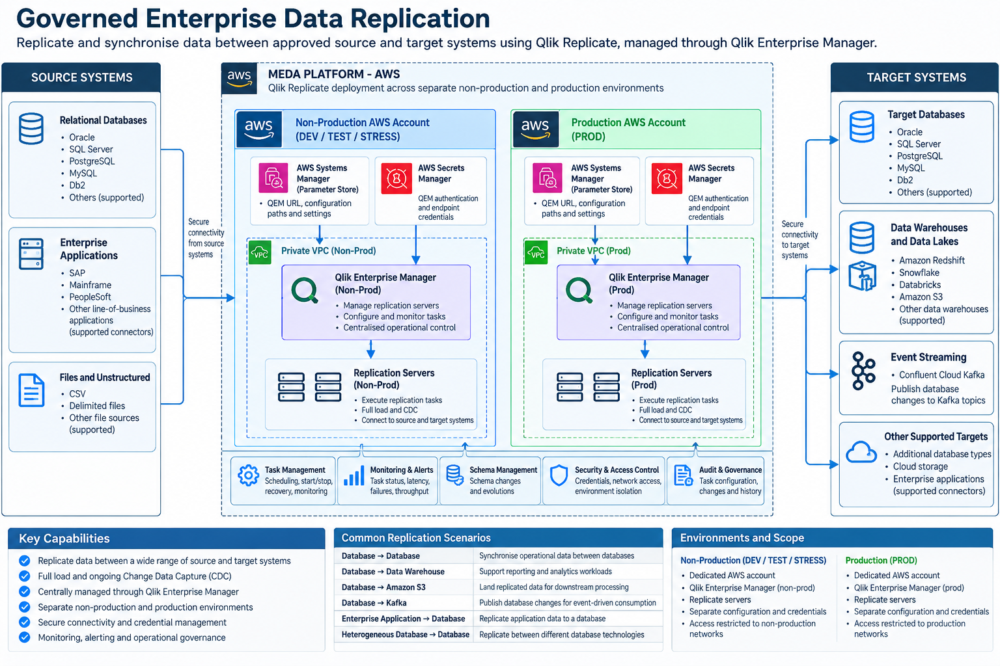

# Governed Enterprise Data Replication

## 1. Introduction

The **Governed Enterprise Data Replication** architectural pattern defines how data is securely replicated and synchronised between approved source and target systems using Qlik Replicate, centrally managed through Qlik Enterprise Manager (QEM).

The pattern establishes a governed approach to enterprise data movement that supports:

- Full-load data replication.
- Ongoing Change Data Capture (CDC).
- Replication between heterogeneous database technologies.
- Database-to-data warehouse integration.
- Database-to-object storage replication.
- Database-to-Kafka change event publication.
- Supported enterprise application and file-based replication.
- Centralised replication task management.
- Source and target connectivity governance.
- Data consistency and schema change management.
- Replication monitoring, recovery and operational control.

The architecture supports multiple source and target technologies without requiring each application team to develop and maintain custom data extraction or synchronisation services.

**Architectural principle:** Enterprise data is replicated from approved source systems to approved target systems through centrally governed replication services, with consistent controls for security, data integrity, monitoring and recovery.

---

## 2. Purpose and Architectural Outcomes

TMR operates enterprise systems that store operational and business data across different database platforms, applications and technology environments.

Business capabilities frequently require data to be made available outside its original source system for:

- Operational reporting.
- Analytics and business intelligence.
- Data warehousing.
- Application integration.
- Data synchronisation.
- Event-driven processing.
- Modernisation of legacy systems.

Direct database integrations and custom extraction processes can introduce tight coupling, duplicated development effort, inconsistent security controls and unnecessary load on operational systems.

The Governed Enterprise Data Replication pattern provides a standardised approach using Qlik Replicate to move and synchronise data between supported source and target technologies.

### 2.1 Architectural Outcomes

The pattern provides:

- Reusable source-to-target replication architecture.
- Reduced need for custom extraction and synchronisation code.
- Support for heterogeneous data platforms.
- Full-load and ongoing CDC capabilities.
- Centrally managed replication tasks.
- Controlled source and target connectivity.
- Consistent credential and access governance.
- Replication latency and health monitoring.
- Managed recovery and restart procedures.
- Environment separation between non-production and production.
- Improved traceability of enterprise data movement.

### 2.2 Core Architectural Decisions

| Decision | Architectural requirement |
|---|---|
| Replication platform | Qlik Replicate provides the approved replication execution capability. |
| Central management | Qlik Enterprise Manager manages and monitors replication servers and tasks. |
| Source systems | Only approved and supported source endpoint technologies may be configured. |
| Target systems | Only approved and supported target endpoint technologies may be configured. |
| Replication methods | Full load, CDC or combined full load and CDC are selected according to source capability and business requirements. |
| Environment isolation | Non-production and production replication environments remain independently governed. |
| Connectivity | Source and target connectivity uses approved network paths. |
| Authentication | Credentials and access permissions are centrally governed. |
| Data integrity | Replication must address consistency, schema evolution and recovery. |
| Observability | Task health, latency, failures and operational status must be monitored. |
| Ownership | Source owners, target owners and replication platform operators have defined responsibilities. |

---

## 3. When to Use This Pattern

Use this pattern when enterprise data must be replicated or synchronised between supported source and target systems.

Typical scenarios include:

- Replicating operational database tables into another database.
- Synchronising data between different relational database platforms.
- Loading enterprise data into an analytics warehouse.
- Replicating operational data into Amazon S3.
- Publishing database changes into Confluent Cloud Kafka.
- Maintaining downstream datasets using ongoing CDC.
- Migrating or modernising systems while maintaining data synchronisation.
- Supporting analytics without requiring reporting workloads to query operational databases directly.

### 3.1 When Not to Use This Pattern

This pattern should not automatically be used for every data integration requirement.

For example:

- Synchronous request-response integration should use an approved API integration pattern.
- Application-owned business events should normally be published through an approved event-driven integration approach.
- Complex business orchestration should not be implemented as database replication.
- Replication should not bypass source-system data ownership or security requirements.
- A one-time data transfer may not justify a continuously managed replication service.
- Qlik Replicate should not be selected where the required source or target connector is unsupported.

### 3.2 Selection Guidance

| Requirement | Recommended approach |
|---|---|
| Database-to-database synchronisation | Qlik Replicate |
| Operational database to data warehouse | Qlik Replicate |
| Database changes to Kafka | Qlik Replicate with an approved Kafka target |
| Operational data to Amazon S3 | Qlik Replicate with an approved S3 target |
| Initial dataset migration | Qlik Replicate full-load capability |
| Ongoing database changes | Qlik Replicate CDC |
| API-based business transaction | Governed API integration |
| Application-generated business events | Governed event-driven integration |
| Complex stream enrichment | Governed Private Event Processing |

---

## 4. Solution Architecture

### 4.1 Solution Architecture Diagram



The architecture demonstrates the separation between source systems, Qlik replication services and target systems.

It also illustrates the independent non-production and production replication environments.

### 4.2 Logical Architecture

Qlik Enterprise Manager provides the management plane. Qlik Replicate servers execute the replication workloads and connect to configured source and target endpoints.

### 4.3 Source Systems

Supported source systems may include:

- Oracle.
- Microsoft SQL Server.
- PostgreSQL.
- MySQL.
- IBM Db2.
- Other supported relational databases.
- Supported enterprise application sources.
- Supported file-based sources.

Actual connector availability and capabilities must be validated against the deployed Qlik Replicate version and licensing.

### 4.4 Target Systems

Supported target systems may include:

- Relational databases.
- Amazon Redshift.
- Amazon S3.
- Supported cloud data warehouses.
- Confluent Cloud Kafka.
- Other supported enterprise data platforms.

Not every source-to-target combination supports the same replication features or delivery characteristics.

### 4.5 Replication Execution

Qlik Replicate executes replication tasks using the configured source and target endpoints.

Each task defines:

- Source endpoint.
- Target endpoint.
- Tables and schemas.
- Replication mode.
- Transformation settings where supported.
- Error handling.
- Operational settings.

---

## 5. Architectural Governance and Tenancy

### 5.1 Qlik Enterprise Manager

Qlik Enterprise Manager provides centralised management and operational visibility for Qlik Replicate servers.

Its responsibilities include:

- Replication server management.
- Task discovery and administration.
- Task monitoring.
- Operational status.
- Centralised visibility across managed replication services.

QEM is the management plane and does not replace the replication execution capability provided by Qlik Replicate.

### 5.2 Qlik Replicate Servers

Qlik Replicate servers execute configured replication tasks.

Their responsibilities include:

- Connecting to source endpoints.
- Reading source data.
- Performing full-load operations.
- Capturing supported source changes.
- Applying supported transformations.
- Writing to target endpoints.
- Managing replication state and recovery.

### 5.3 MEDA Environment Separation

The existing MEDA architecture separates Qlik management and replication environments.

| Environment | Scope | Governance boundary |
|---|---|---|
| Non-Production | DEV, TEST, STRESS | Dedicated non-production AWS account and QEM environment |
| Production | PROD | Dedicated production AWS account and QEM environment |

The two environments must maintain independent access controls, credentials and operational governance.

### 5.4 AWS Integration Services

The MEDA AWS environment provides supporting configuration and security services.

These may include:

- AWS Systems Manager Parameter Store.
- AWS Secrets Manager.
- IAM roles and policies.
- Private VPC networking.
- Approved logging and monitoring services.

### 5.5 Separation of Responsibilities

| Responsibility | Owner |
|---|---|
| Source data ownership | Source system owner |
| Target data ownership | Target system owner |
| Qlik platform operation | MEDA replication platform team |
| Replication task configuration | Authorised replication administrators |
| Source connectivity | Source and network teams |
| Target connectivity | Target and network teams |
| Data classification and access | Applicable data owners and governance teams |
| Monitoring and incident response | Defined operational support teams |

---

## 6. Source and Target Endpoint Configuration

### 6.1 Source Endpoints

A source endpoint defines how Qlik Replicate connects to and reads data from the originating system.

Configuration may include:

- Source technology.
- Hostname and port.
- Database or service identifier.
- Authentication method.
- Connection parameters.
- Tables and schemas.
- CDC prerequisites.
- Required permissions.

### 6.2 Target Endpoints

A target endpoint defines where replicated data is written.

Configuration may include:

- Target technology.
- Hostname or service endpoint.
- Database, bucket or topic destination.
- Authentication.
- Output format.
- Table or object naming.
- Write permissions.
- Target-specific performance settings.

### 6.3 Endpoint Compatibility

The architecture must validate:

- Supported source connector.
- Supported target connector.
- Supported replication mode.
- Data type compatibility.
- Schema evolution support.
- Transactional behaviour.
- Required database permissions.
- Connector licensing.

### 6.4 Endpoint Security

Source and target endpoints must use approved authentication and network connectivity.

Credentials must not be embedded in architecture documentation, source repositories or unsecured configuration files.

---

## 7. Replication Methods – Full Load and CDC

### 7.1 Full Load

Full-load replication copies the selected source dataset into the target.

It is typically used for:

- Initial data population.
- Data migration.
- Reinitialisation.
- Recovery where a complete reload is required.

### 7.2 Change Data Capture

CDC captures supported changes occurring after the initial load or from a configured starting position.

Depending on the source technology, these changes may include:

- Inserts.
- Updates.
- Deletes.

### 7.3 Combined Full Load and CDC

A common replication approach combines an initial full load with ongoing CDC.

```text
Source Database
       |
       v
Qlik Replicate
       |
       +---- Initial Full Load ----+
       |                           |
       +---- Ongoing CDC ----------+
                                   |
                                   v
                             Target System
```

The implementation must ensure a consistent transition between the initial load and ongoing change capture.

### 7.4 Replication Mode Selection

The selected mode depends on:

- Business latency requirements.
- Source capabilities.
- Target capabilities.
- Data volume.
- Consistency requirements.
- Recovery objectives.

### 7.5 Replication Is Not Automatically Bidirectional

This pattern describes governed source-to-target replication.

Bidirectional replication, conflict resolution and active-active synchronisation require separate architectural assessment and must not be assumed to be supported by every endpoint combination.

---

## 8. Connectivity and Infrastructure

### 8.1 Source Connectivity

Qlik Replicate servers require approved network connectivity to configured source systems.

The design must define:

- Source hostname.
- Port.
- Network route.
- Firewall requirements.
- Authentication.
- Encryption.
- Availability.

### 8.2 Target Connectivity

Qlik Replicate servers also require approved connectivity to target systems.

The design must define:

- Destination endpoint.
- Required network path.
- Write permissions.
- Encryption.
- Service limits.
- Failure handling.

### 8.3 Private Networking

Where required, connectivity must use approved private VPC and enterprise network paths.

Source and target connectivity must not introduce unmanaged access into MEDA environments.

### 8.4 Environment Isolation

Non-production replication services must not be able to access production data or systems unless specifically authorised through an approved exception.

Production replication must use production-approved credentials and connectivity.

### 8.5 Network Dependency Management

Replication designs must identify dependencies on:

- Enterprise DNS.
- Private routing.
- Firewalls.
- Database listeners.
- Cloud service endpoints.
- VPN or private connectivity where applicable.

---

## 9. Identity and Access Governance

### 9.1 Source Authentication

Qlik Replicate connects to source systems using approved source-specific credentials or authentication mechanisms.

Permissions should be restricted to the operations required for replication.

### 9.2 Target Authentication

Target credentials must provide only the permissions required to create, update or write the approved replicated data.

### 9.3 Management Identity

Access to Qlik Enterprise Manager and Qlik Replicate administration must be restricted to authorised operational personnel and services.

### 9.4 Credential Management

The MEDA architecture uses approved AWS configuration and secret-management services.

For example:

- Parameter Store for configuration references.
- Secrets Manager for authentication credentials.

### 9.5 Identity Separation

The architecture must distinguish:

- QEM administration identity.
- Qlik Replicate server administration identity.
- Source endpoint identity.
- Target endpoint identity.
- Monitoring and automation identities.

These identities must not be assumed to have equivalent permissions.

### 9.6 Least Privilege

All replication identities must follow least-privilege principles.

Source access should not grant unnecessary write permissions.

Target access should not grant unrelated administrative permissions.

---

## 10. Data Integrity and Consistency

### 10.1 Data Consistency

Replication tasks must maintain the consistency guarantees supported by the selected source and target technologies.

The architecture must assess:

- Initial load consistency.
- Transaction boundaries.
- Change ordering.
- Source commits.
- Target apply behaviour.
- Recovery after interruption.

### 10.2 Source-to-Target Mapping

Replication configuration must define:

- Source schemas.
- Target schemas.
- Table selection.
- Column selection.
- Data type mapping.
- Naming transformations.
- Excluded objects.

### 10.3 Data Type Compatibility

Source and target technologies may use different data types.

The solution must validate supported mappings and identify potential precision, encoding or semantic differences.

### 10.4 Data Validation

Where required, validation should compare source and target datasets.

Examples include:

- Row counts.
- Primary key coverage.
- Checksums.
- Data reconciliation.
- Replication lag.
- Exception reporting.

### 10.5 Replication Versus Business Transformation

Qlik Replicate may support transformations appropriate to its replication capabilities.

Complex business transformations, orchestration and analytical enrichment should use the appropriate downstream processing capability rather than unnecessarily coupling business logic to replication tasks.

---

## 11. Schema Evolution and Change Management

### 11.1 Source Schema Changes

Source systems may change over time.

Examples include:

- New tables.
- New columns.
- Column removal.
- Data type changes.
- Table renaming.
- Primary key changes.

### 11.2 Target Compatibility

Not every source schema change can be automatically applied to every target.

The architecture must define:

- Supported change propagation.
- Target compatibility requirements.
- Approval processes.
- Failure handling.
- Recovery procedures.

### 11.3 Change Governance

Changes to replicated datasets must be coordinated with source and target owners.

### 11.4 Data Contract Implications

Where replication feeds downstream applications or Kafka topics, schema changes may affect consumers.

The design must address downstream compatibility and governance requirements.

### 11.5 Controlled Deployment

Replication task changes must be reviewed, tested and promoted through approved environment processes.

---

## 12. Replication to Kafka and Event Streaming

### 12.1 Kafka as a Target

Qlik Replicate may publish supported database changes to Kafka using an approved target configuration.

This enables downstream event-driven applications to consume database change records.

### 12.2 Logical Architecture

```text
Operational Database
        |
        v
    Qlik Replicate
        |
        v
   Confluent Cloud Kafka
        |
        v
   Downstream Consumers
```

### 12.3 CDC Events Versus Business Events

A database change event is not necessarily equivalent to a business domain event.

For example:

- A CDC event may indicate that a database row was updated.
- A business event may indicate that a licence was approved.

The architecture must not assume these have equivalent semantics.

### 12.4 Event Contract Governance

Kafka targets must comply with applicable MEDA requirements for:

- Topic ownership.
- Naming.
- Schema management.
- Access controls.
- Data classification.
- Retention.
- Error handling.
- Consumer compatibility.

### 12.5 Relationship to Event Ingestion Patterns

The Governed Enterprise Data Replication pattern defines how Qlik Replicate captures and transfers data.

The Governed Multi-Protocol Integration Layer defines how data enters the MEDA Event Backbone under consistent ingestion governance.

Both patterns may apply when Qlik Replicate publishes database changes to Kafka.

---

## 13. Replication to Databases, Warehouses and Object Storage

### 13.1 Database Targets

Qlik Replicate can support synchronisation into approved database targets.

Typical use cases include:

- Operational reporting databases.
- Application data synchronisation.
- Platform modernisation.
- Data consolidation.

### 13.2 Data Warehouse Targets

Replication into approved data warehouse platforms can support:

- Analytics.
- Business intelligence.
- Reporting.
- Data integration.
- Downstream transformation.

### 13.3 Amazon S3 Targets

Replication into Amazon S3 can support:

- Data lake ingestion.
- Historical datasets.
- Downstream analytics.
- Batch processing.
- Data engineering pipelines.

### 13.4 Target-Specific Design

Each target requires assessment of:

- Supported output format.
- Data structure.
- Change representation.
- Target write behaviour.
- Retention.
- Partitioning.
- Recovery.
- Security.

### 13.5 Target Ownership

Replicated datasets must have defined ownership.

Replication does not remove the need for data governance, access management or lifecycle management at the target.

---

## 14. Replication Task Management

### 14.1 Task Definition

Each replication task must identify:

- Source endpoint.
- Target endpoint.
- Replicated objects.
- Replication mode.
- Configuration.
- Operational ownership.

### 14.2 Task Lifecycle

Task management may include:

- Creation.
- Configuration.
- Validation.
- Start.
- Stop.
- Resume.
- Reload.
- Recovery.
- Retirement.

### 14.3 Qlik Enterprise Manager

QEM provides centralised visibility and management of the configured replication environment.

### 14.4 Environment Configuration

Replication tasks must use environment-specific endpoints and credentials.

Configuration must not unintentionally connect non-production tasks to production systems.

### 14.5 Task Retirement

Retiring a replication task must include:

- Approval from source and target owners.
- Controlled task shutdown.
- Credential cleanup.
- Removal of obsolete configuration.
- Target data retention decisions.
- Operational documentation updates.

---

## 15. Monitoring and Observability

### 15.1 Replication Monitoring

The platform must provide visibility into:

- Task state.
- Replication progress.
- Source connectivity.
- Target connectivity.
- Replication latency.
- Errors.
- Warnings.
- Throughput.
- Recovery status.

### 15.2 Qlik Enterprise Manager Monitoring

QEM provides centralised visibility across managed replication servers and tasks.

### 15.3 Enterprise Observability

Replication monitoring should integrate with approved MEDA operational monitoring and alerting capabilities where supported.

### 15.4 Alerting

Alerts should be defined for:

- Task failure.
- Source connection failure.
- Target connection failure.
- Excessive replication latency.
- Replication backlog.
- Unsupported schema changes.
- Resource exhaustion.
- Repeated recovery failures.

### 15.5 Operational Traceability

Operational records should support identification of:

- Replication task.
- Source system.
- Target system.
- Environment.
- Replication status.
- Relevant timestamps.
- Failure conditions.

---

## 16. Resiliency, Recovery and Performance

### 16.1 Failure Isolation

Failure of one replication task should not unnecessarily affect unrelated tasks.

### 16.2 Recovery

The architecture must define recovery procedures for:

- Source outages.
- Target outages.
- Network interruption.
- Replication server failure.
- Task failure.
- Schema incompatibility.
- Insufficient source log retention.

### 16.3 CDC Recovery

CDC recovery depends on the availability of the required source change history.

The design must account for:

- Database log retention.
- Replication checkpoints.
- Recovery positions.
- Restart behaviour.
- Reinitialisation requirements.

### 16.4 Full-Load Performance

Full-load operations must be assessed for:

- Source database impact.
- Data volume.
- Network throughput.
- Target write capacity.
- Parallelism.
- Load windows.

### 16.5 CDC Performance

Ongoing replication must be assessed for:

- Source change rate.
- Replication latency.
- Target apply capacity.
- Backlog growth.
- Peak transaction periods.

### 16.6 Recovery Objectives

The solution must define applicable recovery and data freshness objectives.

Replication is not automatically equivalent to backup, disaster recovery or zero-data-loss synchronisation.

---

## 17. Architecture Implementation Checklist

Before adopting this pattern, the solution architect must confirm the following.

| Area | Required assessment |
|---|---|
| Business requirement | Why is replication required? |
| Source system | Is the source identified and approved? |
| Target system | Is the target identified and approved? |
| Connector support | Are source and target technologies supported? |
| Replication mode | Is full load, CDC or combined replication required? |
| Data ownership | Are source and target data owners identified? |
| Environment | Is the correct non-production or production environment selected? |
| QEM | Is the appropriate Qlik Enterprise Manager environment identified? |
| Replicate server | Is the approved execution server selected? |
| Source endpoint | Are connectivity and credentials defined? |
| Target endpoint | Are connectivity and credentials defined? |
| Data selection | Are tables, schemas and columns defined? |
| Data mapping | Are data type and schema mappings validated? |
| Consistency | Are source-to-target consistency requirements defined? |
| CDC prerequisites | Are source logging and permissions configured? |
| Schema evolution | Are schema change handling requirements defined? |
| Security | Are encryption, least privilege and secret management addressed? |
| Data classification | Are applicable handling requirements satisfied? |
| Performance | Have data volume, latency and throughput been assessed? |
| Monitoring | Are task health, latency and failures monitored? |
| Recovery | Are restart, replay and reload procedures defined? |
| Operations | Are support responsibilities assigned? |
| Lifecycle | Are change, promotion and retirement processes defined? |

---

## 18. The Governed Replication Outcome

The Governed Enterprise Data Replication pattern provides a standard approach for moving and synchronising enterprise data between approved systems.

The architecture ensures:

- Controlled source-to-target replication.
- Support for heterogeneous technologies.
- Full-load and CDC capabilities.
- Centralised replication management.
- Environment isolation.
- Secure connectivity.
- Governed credentials.
- Data integrity and consistency controls.
- Schema change management.
- Operational monitoring.
- Recoverability.
- Clear ownership and accountability.

The pattern enables TMR to reuse a centrally managed replication capability instead of implementing independent data extraction and synchronisation solutions for each application.

**Final architectural principle:**

> Enterprise data replication must be source-aware, target-aware and centrally governed, with Qlik Replicate providing the execution capability and Qlik Enterprise Manager providing operational management and visibility.

---

## 19. Related Architectural Patterns

### Governed Multi-Protocol Integration Layer

Defines how Kafka-native applications and non-Kafka source systems securely publish events into the MEDA Event Backbone.

This pattern may be used alongside Governed Enterprise Data Replication when Qlik Replicate publishes CDC records to Kafka.

### Governed Private Event Processing

Defines how trusted event streams are processed, enriched and persisted within the MEDA platform.

It may apply when replicated database changes require downstream processing through Kafka and Flink.

### Governed Internal API Gateway

Defines how internal TMR applications access approved APIs through MuleSoft Flex Gateway.

It may complement replicated datasets that are exposed through internal API services.

### Governed External API Gateway

Defines how approved external consumers access TMR APIs through AWS API Gateway and the private MEDA API management platform.

It may complement solutions where replicated data supports externally exposed business APIs.

### Related Architectural Capabilities

This pattern may also be used alongside architectural guidance for:

- Enterprise data governance.
- Database security.
- Data warehousing.
- Data lake ingestion.
- Kafka event streaming.
- CDC schema management.
- Data quality and reconciliation.
- Enterprise observability.

---

## 20. Pattern Classification

**Architectural pattern:** Governed Enterprise Data Replication

**Category:** Data Integration

**Enterprise asset identifier:**

`pattern/governed-enterprise-data-replication`

**Primary technology:** Qlik Replicate

**Management capability:** Qlik Enterprise Manager

**Applicability:** Replication and synchronisation of data between approved enterprise source and target systems.

**Primary capabilities:**

- Full-load replication.
- Change Data Capture.
- Heterogeneous source and target integration.
- Database replication.
- Data warehouse replication.
- Amazon S3 replication.
- Kafka target publication.
- Replication task management.
- Source and target connectivity governance.
- Data consistency and schema evolution.
- Operational monitoring and recovery.
- Production and non-production environment separation.

The pattern's stable identifier is defined by the YAML front matter and does not depend on the repository directory or category.

The architecture is reusable across MEDA solutions and does not prescribe specific source databases, target systems, replication tasks or application implementations.