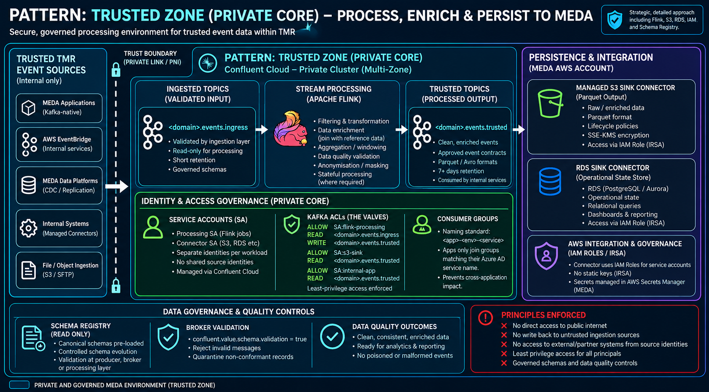

# Governed Private Event Processing

## 1. Introduction

The **Governed Private Event Processing** architectural pattern defines the trusted, privately accessible streaming and processing environment within the TMR Microservices and Event-Driven Architecture (MEDA) platform.

The pattern establishes how event data is securely consumed, validated, transformed, enriched, distributed and persisted within a governed enterprise environment.

It complements the **Governed Multi-Protocol Integration Layer** architectural pattern, which defines how Kafka-native applications and systems using alternative integration protocols securely publish events into the MEDA Event Backbone.

Governed Private Event Processing provides:

- Private Kafka event streaming.
- Managed stream processing using Apache Flink.
- Event validation, transformation and enrichment.
- Schema governance and data quality controls.
- Controlled publication into trusted event topics.
- Secure persistence into MEDA-managed storage services.
- Enterprise identity and access governance.
- Operational observability, replay and recovery.
- Isolation from public-facing systems and untrusted source identities.

The pattern is designed for workloads operating within the trusted MEDA environment and does not require a particular upstream ingestion mechanism.

**Architectural principle:** Events entering the private processing environment are subject to continuing identity, schema, data quality and operational governance. Private network placement does not automatically establish data trust.

---

## 2. Purpose and Architectural Outcomes

The TMR integration landscape requires a secure and scalable capability for processing enterprise events without exposing internal streaming infrastructure, data assets or application identities to untrusted networks.

Applications may require:

- Real-time processing of business events.
- Aggregation of high-volume telemetry.
- Enrichment using enterprise reference data.
- Transformation into approved event contracts.
- Filtering and routing of operational events.
- Secure consumption by internal microservices.
- Persistence of event data for analytics and operational queries.

Implementing these capabilities independently within each application would introduce duplicated processing logic, inconsistent governance and unnecessary operational complexity.

Governed Private Event Processing establishes a shared architectural approach for these requirements.

### 2.1 Architectural Outcomes

The pattern provides:

- A privately accessible enterprise event-processing environment.
- Separation between source ingestion and trusted processing.
- Consistent event schema and data quality governance.
- Managed stream processing and enrichment.
- Controlled access to event streams.
- Secure integration with enterprise data stores.
- Independent scaling of processing and persistence.
- Resilient processing with defined recovery mechanisms.
- Operational visibility across event-processing workloads.

### 2.2 Core Architectural Decisions

| Decision | Architectural requirement |
|---|---|
| Event backbone | Kafka provides the governed streaming backbone for MEDA. |
| Private connectivity | Private processing infrastructure is accessed through approved private network paths. |
| Stream processing | Apache Flink is the preferred managed processing capability where streaming transformations are required. |
| Trusted publication | Events must satisfy applicable governance requirements before publication into trusted topics. |
| Schema governance | Event contracts are managed through approved schema governance processes. |
| Identity separation | Source, processing, connector and consumer identities are independently governed. |
| Least privilege | Applications and processing components receive only the permissions required for their responsibilities. |
| Persistence | S3, RDS and other approved storage services may be used according to solution requirements. |
| Delivery guarantees | Processing workloads must define their delivery, ordering, recovery and replay behaviour. |
| Operational ownership | Every processing workload must have defined ownership, monitoring and support arrangements. |

---

## 3. When to Use This Pattern

Use this pattern when enterprise events require governed processing, enrichment, distribution or persistence within the private MEDA environment.

Typical scenarios include:

- Real-time transformation of incoming business events.
- Aggregation of high-volume operational telemetry.
- Enrichment using enterprise reference datasets.
- Data quality validation before trusted publication.
- Filtering and routing of events to downstream consumers.
- Processing database change events.
- Building event-driven operational state.
- Preparing event streams for analytics and reporting.
- Persisting curated event data into enterprise storage services.

### 3.1 When Not to Use This Pattern

This pattern should not introduce unnecessary processing components where the source event already satisfies the consumer's requirements.

For example:

- A Kafka event that already conforms to an approved contract may be consumed directly by an authorised application.
- Flink should not be introduced solely to copy an unchanged event between topics without an architectural requirement.
- Simple synchronous request-response interactions should not automatically be converted into streaming workloads.
- Kafka should not be used as a replacement for object storage when the primary requirement is to store large binary assets.
- An additional private Kafka cluster should not be created unless justified by security, isolation, networking, capacity or operational requirements.

### 3.2 Selection Guidance

| Processing requirement | Preferred approach |
|---|---|
| Event already satisfies its contract | Governed Kafka consumption |
| Event filtering or routing | Kafka-native processing or approved streaming capability |
| Stateful transformation or aggregation | Managed Apache Flink |
| Reference data enrichment | Flink or approved enrichment service |
| Data quality validation | Approved validation or processing pipeline |
| Historical event persistence | Approved S3 sink or ingestion service |
| Operational state materialisation | Approved database sink or application |
| Large binary payload retrieval | Claim-check using approved object storage |
| Analytics-ready event streams | Governed transformation and curated topics |

The selected implementation must be assessed against latency, throughput, data classification, resilience and operational requirements.

---

## 4. Solution Architecture

### 4.1 Logical Architecture



The pattern separates governed event ingestion, private processing, trusted publication and downstream consumption.


This is a logical architecture.

Not every implementation requires every component. For example, a conformant event may be consumed directly without passing through Flink.

### 4.2 Governed Event Ingress

Events may enter the private processing environment through approved integration mechanisms.

Examples include:

- Kafka-native publication.
- AWS EventBridge-to-Kafka integration.
- Managed connectors.
- Database CDC.
- Object storage ingestion.
- Controlled cluster-to-cluster replication.
- Approved ingestion applications.

The upstream mechanism must satisfy the applicable MEDA connectivity, identity and security requirements.

### 4.3 Private Processing Boundary

The private processing boundary provides controlled access to the enterprise streaming and processing environment.

Its responsibilities include:

- Restricting network exposure.
- Enforcing Kafka authentication and authorisation.
- Separating source and processing identities.
- Applying approved schema governance.
- Controlling processing workloads.
- Protecting downstream consumers and persistence services.

### 4.4 Trusted Event Publication

Processed events are published into approved trusted Kafka topics.

Publication must satisfy applicable requirements for:

- Schema conformance.
- Data quality.
- Source provenance.
- Event ownership.
- Security classification.
- Authorisation.
- Operational monitoring.

The processing boundary does not automatically make every event trusted. Trust is established through the applicable governance controls.

---

## 5. Architectural Governance and Tenancy

### 5.1 Streaming and Processing Plane – Confluent Cloud

Confluent Cloud provides the managed streaming and processing capabilities used by MEDA.

Depending on the approved deployment architecture, these may include:

- Kafka clusters.
- Kafka topics.
- Schema Registry.
- Apache Flink compute pools.
- Managed connectors.
- Kafka service accounts.
- ACLs and RBAC.
- Monitoring and operational controls.

Where the security and networking requirements mandate a dedicated private Kafka environment, the solution must use an approved private cluster and connectivity model.

### 5.2 Data and Enterprise Control Plane – MEDA AWS

The MEDA AWS environment provides enterprise-controlled persistence and supporting services.

These may include:

- S3 buckets.
- RDS or Aurora databases.
- AWS Secrets Manager.
- IAM roles and policies.
- Enterprise reference data.
- Audit storage.
- Operational monitoring services.
- Data lineage capabilities.

Persistence components are selected according to solution requirements and are not mandatory for every processing workload.

### 5.3 Private Integration Boundary

Connectivity between Confluent Cloud and MEDA AWS must use approved network mechanisms.

These may include:

- AWS PrivateLink.
- Approved private network connectivity.
- Private DNS.
- Controlled routing.
- Approved security group and firewall policies.

The specific mechanism must be supported by the selected Confluent Cloud service and deployment model.

### 5.4 Governance Responsibilities

The MEDA platform team governs shared streaming infrastructure, security controls and approved processing capabilities.

Individual solution teams remain responsible for:

- Event contract ownership.
- Processing logic.
- Data quality requirements.
- Consumer requirements.
- Workload monitoring.
- Operational support.
- Recovery procedures.

---

## 6. Private Event Processing Configuration

| Capability | Architectural requirement |
|---|---|
| Kafka connectivity | Approved private network access |
| Kafka authentication | Supported enterprise-approved authentication |
| Authorisation | Least-privilege ACLs and RBAC |
| Schema governance | Approved schemas and compatibility policies |
| Stream processing | Managed Flink where required |
| Event transformation | Controlled mapping and enrichment |
| Trusted publication | Approved output topics and event contracts |
| Persistence | Approved S3, database or other storage targets |
| Source provenance | Original source identity retained |
| Delivery guarantees | Explicitly documented per processing pipeline |
| Failure handling | Retry, quarantine and recovery |
| Monitoring | Operational metrics, logs and alerts |
| Data protection | Approved classification and encryption controls |

---

## 7. Private Connectivity and Infrastructure

### 7.1 Private Network Access

The private processing environment must be accessible only through approved network paths.

Requirements include:

- No unnecessary public-facing Kafka endpoints.
- Private connectivity for internal workloads where required.
- Controlled DNS resolution.
- Approved routing and firewall rules.
- Encryption in transit.
- Restricted administrative access.

### 7.2 Separation from Untrusted Sources

External devices, partners and untrusted source systems must not receive direct access to private processing infrastructure unless explicitly authorised through an approved architecture.

Where source data crosses an external trust boundary, an appropriate governed ingress mechanism must be used.

### 7.3 Directional Data Movement

The direction of data movement must be explicitly defined.

For example, an external-to-private ingestion architecture may enforce:

```text
External Source
      |
      v
Governed Ingress Boundary
      |
      v
Private Kafka Environment
      |
      v
Trusted Processing
```

A private processing environment must not automatically establish a reverse path to external systems.

Any outbound integration requires separately approved connectivity, identity and security controls.

### 7.4 Cluster Isolation

Where multiple Kafka clusters are used, the architecture must define:

- Cluster responsibilities.
- Trust boundaries.
- Topic replication direction.
- Replication identities.
- Network connectivity.
- Failure isolation.
- Recovery procedures.

A separate private Kafka cluster is an implementation decision driven by architectural requirements, not a universal requirement for every event-processing workload.

---

## 8. Stream Processing – Apache Flink

### 8.1 Purpose

Apache Flink provides managed stream processing for workloads requiring continuous transformation, aggregation, enrichment or stateful event processing.

### 8.2 Processing Capabilities

Supported processing requirements may include:

**Filtering**

Removing irrelevant events or routing records according to business rules.

**Transformation**

Converting source records into approved event contracts.

**Aggregation**

Combining high-frequency events into summaries or derived metrics.

**Enrichment**

Joining event streams with reference data or other approved datasets.

**Data Quality**

Identifying malformed, incomplete or non-compliant records.

**Masking and Anonymisation**

Removing or transforming sensitive fields where required.

**Stateful Processing**

Maintaining processing state for joins, windows, deduplication and other streaming operations.

### 8.3 Processing Architecture

```text
Kafka Ingress Topic
        |
        v
   Apache Flink
        |
        +---- Filtering
        |
        +---- Transformation
        |
        +---- Enrichment
        |
        +---- Aggregation
        |
        +---- Data Quality
        |
        v
Trusted Kafka Topic
```

### 8.4 Processing Isolation

Processing workloads must be designed to minimise unnecessary coupling.

Where appropriate:

- Separate independently deployable processing capabilities.
- Isolate failure-prone workloads.
- Define explicit Kafka input and output contracts.
- Use governed intermediate topics where required.
- Avoid unnecessary dependencies between processing jobs.
- Establish clear processing ownership.

### 8.5 Processing State

Stateful Flink workloads must define:

- State retention.
- Checkpointing or recovery mechanisms.
- Restart behaviour.
- Source offset handling.
- Schema evolution impacts.
- Recovery after partial processing.

---

## 9. Schema Governance and Data Integrity

### 9.1 Schema Registry

Schema Registry provides governance for supported event schema formats.

Approved schema management must address:

- Schema ownership.
- Compatibility rules.
- Version management.
- Controlled schema changes.
- Producer and consumer contracts.
- Schema lifecycle management.

### 9.2 Schema Validation

Schema Registry does not automatically guarantee that all published Kafka records are valid.

Validation may occur through:

- Producer-side validation.
- Broker-side schema validation where supported and configured.
- Stream-processing validation.
- Approved ingestion or transformation services.
- Consumer-side contract enforcement.

The selected validation controls must be documented.

### 9.3 Raw and Trusted Data

The architecture must distinguish between raw source records and trusted event streams where applicable.

```text
Raw Event Topic
       |
       v
Validation / Transformation
       |
       +---- Invalid ----> Quarantine
       |
       v
Trusted Event Topic
```

### 9.4 Data Quality

Processing workloads may enforce:

- Mandatory fields.
- Valid data types.
- Accepted values.
- Referential checks.
- Business validation rules.
- Duplicate handling.
- Sensitive data controls.

### 9.5 Schema Evolution

Changes to event contracts must follow approved governance processes.

Processing and consuming applications must be assessed for compatibility before incompatible changes are introduced.

---

## 10. Identity and Access Governance – Internal Identity Plane

### 10.1 Enterprise Identity Model

The private processing environment uses approved enterprise identity and access controls.

Identities must be independently governed for:

- Kafka producers.
- Flink processing workloads.
- Managed connectors.
- Internal applications.
- Operational administrators.

An identity used by an external source must not automatically inherit access to private processing resources.

### 10.2 Processing Identities

Each processing workload must use an appropriately scoped identity.

For example:

```text
Principal: User:meda-flink-processing
READ:  meda.events.ingress
WRITE: meda.events.trusted
```

This example is illustrative. Actual permissions must use the approved Kafka authorisation model.

### 10.3 Connector Identities

Persistence connectors must use independently governed identities.

For example:

```text
Principal: User:meda-s3-sink
READ: meda.events.trusted
```

The connector must also have appropriately scoped access to its destination storage service.

### 10.4 Internal Consumer Identities

Internal applications authenticate through approved Kafka-supported authentication mechanisms.

Where enterprise identity federation is used, its compatibility with the selected Kafka service must be validated.

Consumer permissions must be limited to approved topics and consumer groups.

### 10.5 Consumer Group Governance

Consumer groups must follow approved naming and access standards.

Applications must not be granted unrestricted access to unrelated consumer groups.

### 10.6 Identity Separation

The architecture maintains a separation between:

- Source identities.
- Ingestion identities.
- Processing identities.
- Persistence identities.
- Consumer identities.

No single identity should receive permissions spanning unrelated responsibilities without explicit justification.

---

## 11. Claim-Check and Large Payload Processing

### 11.1 Purpose

The claim-check approach separates large binary payloads from lightweight event metadata.

This avoids unnecessary transfer of large files through Kafka.

### 11.2 Metadata Path

Kafka carries event metadata and a reference to the associated payload.

For example:

```json
{
  "eventId": "evt-12345",
  "eventType": "image-captured",
  "sourceSystem": "camera-platform",
  "timestamp": "2026-10-23T04:00:00Z",
  "payloadUri": "s3://approved-bucket/images/evt-12345.jpg"
}
```

### 11.3 Binary Retrieval

Authorised processing services retrieve the referenced object only when required.

The processing service must validate:

- Object access permissions.
- Object existence.
- Data classification.
- Payload integrity.
- Object retention requirements.

### 11.4 Architectural Rule

Kafka carries the governed event and its metadata.

Large binary payloads should remain in approved object storage where appropriate.

Claim-check is optional and applies only when justified by payload characteristics.

---

## 12. Automated Persistence and State Management

### 12.1 S3 Persistence

Approved S3 sink connectors or ingestion services may persist curated event streams into MEDA-managed S3 buckets.

Typical uses include:

- Historical retention.
- Data lake integration.
- Analytics.
- Audit storage.
- Replay datasets.

Where appropriate, data may be stored in formats such as Parquet.

### 12.2 Operational Databases

Approved database sinks or applications may materialise event data into PostgreSQL, Aurora or other supported data stores.

Typical uses include:

- Operational dashboards.
- Query-based services.
- Materialised state.
- Reporting.
- Application lookups.

### 12.3 Persistence Governance

Persistence implementations must define:

- Destination ownership.
- Authentication and authorisation.
- Encryption.
- Retention.
- Data classification.
- Schema mapping.
- Error handling.
- Recovery behaviour.

### 12.4 AWS Access Governance

Where supported, AWS access must use approved IAM roles or temporary credentials rather than long-lived static access keys.

The selected connector or application must support the proposed authentication mechanism.

### 12.5 Architectural Rule

Persistence is driven by business requirements.

The pattern does not mandate both S3 and RDS, nor does it require every Kafka event to be persisted outside Kafka.

---

## 13. Delivery Semantics, Idempotency and Replay

### 13.1 Delivery Guarantees

Each processing pipeline must document its delivery guarantees.

These may include:

- At-most-once.
- At-least-once.
- Exactly-once processing where supported.

End-to-end guarantees must be assessed across all involved components, including external persistence targets.

### 13.2 Duplicate Handling

Processing workloads must address duplicate records where duplicates could affect business correctness.

Strategies may include:

- Stable event identifiers.
- Idempotent processing.
- Deduplication.
- Transactional operations where supported.

### 13.3 Ordering

Kafka ordering is generally scoped to individual partitions.

Processing workloads must define ordering requirements and any assumptions about event keys, partitioning or downstream processing.

### 13.4 Replay

The architecture must define how events can be reprocessed following:

- Processing failures.
- Schema corrections.
- Data quality remediation.
- Downstream outages.
- Operational recovery.

### 13.5 Stateful Recovery

Stateful processing workloads must define checkpointing, restart and state restoration arrangements appropriate to the selected processing service.

---

## 14. Resiliency and Blast Radius Isolation

### 14.1 Processing Isolation

Failure of one processing workload should not unnecessarily affect unrelated event streams or consumers.

### 14.2 Ingestion Independence

Where supported by the selected architecture, upstream ingestion should remain operational during downstream processing failures.

Kafka retention and buffering requirements must be sufficient for expected recovery scenarios.

### 14.3 Failure Handling

Processing workloads must define:

- Retry behaviour.
- Processing failure recovery.
- Quarantine handling.
- Alerting.
- Replay procedures.
- Operational escalation.

### 14.4 Quarantine

Invalid or non-compliant records may be routed to approved quarantine topics.

For example:

```text
meda.events.quarantine
```

The exact naming convention must follow MEDA topic governance standards.

### 14.5 Capacity and Backpressure

Solutions must assess:

- Event throughput.
- Processing latency.
- Flink capacity.
- Kafka quotas.
- Consumer lag.
- Stateful processing requirements.
- Downstream storage capacity.
- Recovery throughput.

---

## 15. Observability, Audit and Lineage

### 15.1 Operational Monitoring

Processing workloads must expose relevant operational metrics.

Examples include:

- Records consumed.
- Records produced.
- Processing latency.
- Processing failures.
- Kafka consumer lag.
- Flink job status.
- State recovery status.
- Quarantine volume.
- Connector failures.

### 15.2 Audit Requirements

The architecture must support traceability across:

- Source topics.
- Processing workloads.
- Output topics.
- Processing identities.
- Persistence destinations.
- Relevant timestamps.
- Failure and recovery events.

### 15.3 Data Lineage

Where required, lineage must identify how source events are transformed into trusted enterprise event streams.

```text
Source Event
     |
     v
Kafka Ingress Topic
     |
     v
Processing Workload
     |
     v
Trusted Kafka Topic
     |
     +----> Microservice
     |
     +----> Analytics
     |
     +----> Persistence
```

---

## 16. Security and Data Protection

### 16.1 Authentication and Authorisation

- Use approved authentication mechanisms.
- Apply least-privilege access.
- Separate processing and consumer identities.
- Restrict access to required topics and services.
- Control administrative access.

### 16.2 Network Security

- Use approved private connectivity.
- Restrict public exposure.
- Apply network segmentation.
- Protect administrative interfaces.
- Encrypt traffic in transit.

### 16.3 Data Protection

- Apply approved encryption at rest.
- Use approved key-management services.
- Respect data classification requirements.
- Mask or anonymise sensitive data where required.
- Apply retention and deletion policies.

### 16.4 Secrets Management

Credentials must be stored and managed through approved secret-management services.

Secrets must not be embedded in source code, SQL statements, connector configurations or event payloads.

### 16.5 Governance Enforcement

Private networking does not replace application or Kafka authorisation.

Network isolation, identity controls, schema governance and operational monitoring must operate together.

---

## 17. Architecture Implementation Checklist

Before adopting this pattern, the solution architect must confirm the following.

| Area | Required assessment |
|---|---|
| Processing requirement | Is private event processing required? |
| Source | Are upstream event sources and ingress mechanisms identified? |
| Connectivity | Are approved private network paths defined? |
| Kafka environment | Is the appropriate cluster and topic configuration selected? |
| Identity | Are producer, processing and consumer identities separated? |
| Authorisation | Are ACLs and RBAC appropriately scoped? |
| Event contracts | Are schemas and ownership defined? |
| Validation | Are data quality and trusted publication controls identified? |
| Flink | Is stream processing necessary and appropriately designed? |
| State management | Are checkpointing and recovery requirements defined? |
| Persistence | Are required storage destinations identified? |
| Claim-check | Is external payload storage required? |
| Delivery | Are delivery guarantees documented? |
| Duplicates | Is idempotency or deduplication addressed? |
| Ordering | Are ordering requirements understood? |
| Replay | Is event reprocessing supported where required? |
| Failure handling | Are retry, quarantine and recovery arrangements defined? |
| Observability | Are metrics, logs and alerts available? |
| Capacity | Have throughput and latency requirements been assessed? |
| Data protection | Are classification, encryption and retention requirements satisfied? |
| Operations | Is ownership and ongoing support assigned? |

---

## 18. The Trusted Processing Outcome

Governed Private Event Processing establishes a secure and controlled environment for processing enterprise events within the MEDA Event Backbone.

The architecture ensures:

- Private access to streaming and processing capabilities.
- Governed event contracts.
- Enterprise identity separation.
- Controlled processing and enrichment.
- Trusted event publication.
- Secure downstream consumption.
- Optional enterprise persistence.
- Operational observability.
- Resilient processing and recovery.
- Separation from untrusted source environments.

The pattern enables TMR to deliver event-driven capabilities without requiring every application to independently implement streaming infrastructure, transformation logic or persistence integration.

**Final architectural principle:**

> Private connectivity establishes the network boundary. Identity, schema, data quality and operational controls establish the trusted processing boundary.

---

## 19. Related Architectural Patterns

### Governed Multi-Protocol Integration Layer

The Governed Multi-Protocol Integration Layer defines how Kafka-native applications and systems using alternative protocols securely publish events into the MEDA Event Backbone.

It covers:

- Kafka-native ingress.
- AWS EventBridge-to-Kafka integration.
- Managed connector ingestion.
- File and object storage ingestion.
- Database and CDC ingestion.
- Source identity separation.
- Governed publication into Kafka.

Governed Private Event Processing complements this architecture by defining how events are processed, enriched, distributed and persisted within the trusted MEDA environment.

The two patterns may be used together, but neither requires the other to be implemented in every solution.

### Related Architectural Capabilities

This pattern may also be used alongside architectural guidance for:

- Kafka topic governance.
- Event schema management.
- Stream processing with Apache Flink.
- Data replication and CDC.
- Event-driven microservices.
- Secure persistence and analytics.
- Enterprise identity and access management.

---

## 20. Pattern Classification

**Architectural pattern:** Governed Private Event Processing

**Category:** Event-Driven Architecture

**Enterprise asset identifier:**

`pattern/governed-private-event-processing`

**Applicability:** Trusted internal streaming and event-processing environments.

**Primary capabilities:**

- Private Kafka streaming.
- Flink processing.
- Event enrichment and transformation.
- Schema governance.
- Enterprise identity and access control.
- Trusted event publication.
- Secure persistence.
- Operational resilience.

The pattern's stable identifier is defined by the YAML front matter and does not depend on the repository directory or category.

The architecture is intended to be reusable across MEDA solutions and does not prescribe SRI-specific topic names, camera identities, storage locations or cluster configurations.